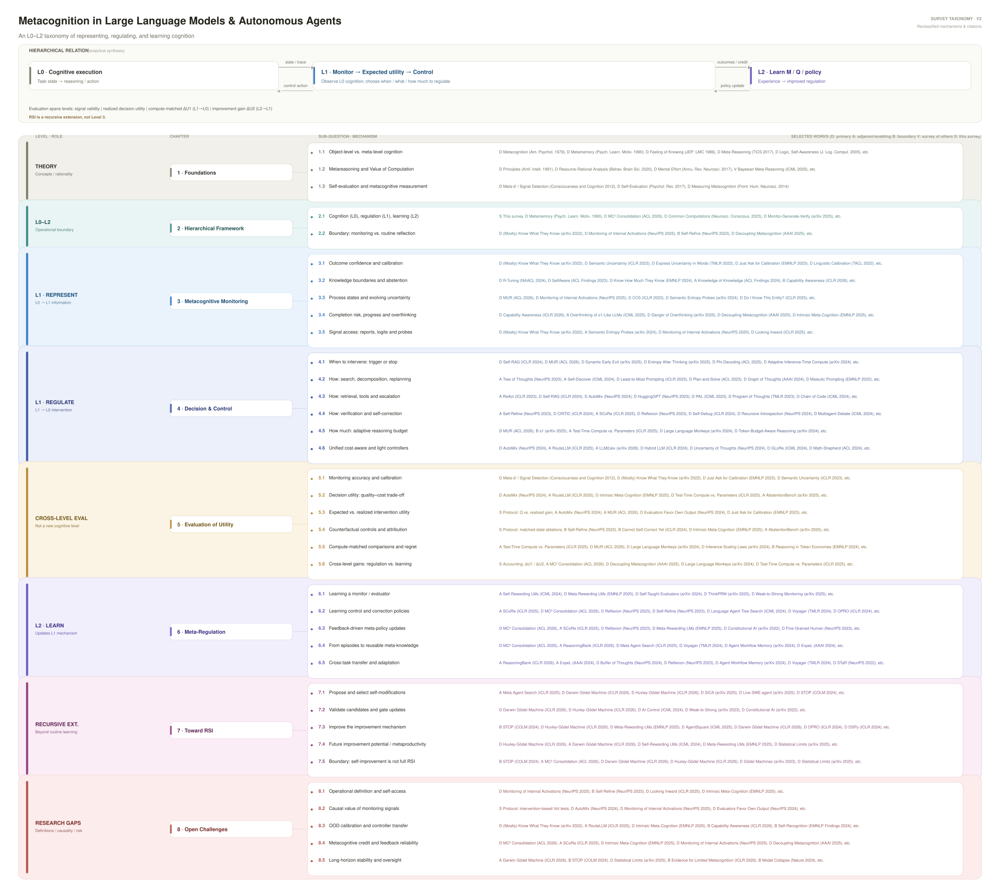

# Metacognition in Large Language Models & Autonomous Agents

*An L0–L2 taxonomy of representing, regulating, and learning cognition*

A curated reading list for a level-structured survey of metacognition in large language models. Unlike a flat paper list, every work carries two facets: the **logical role** it plays in the argument, and the **evidence tier** that says how far it can be trusted. The bibliography therefore doubles as an outline of the reasoning — and makes visible which claims rest on primary metacognitive evidence and which rest on adjacent work.

**390 citations** of **196 distinct works** across **37 sub-questions**, grouped into **8 chapters** and **8 level bands**.

| Tier | Citations | Meaning |
|---|---|---|
| `D` | 229 | **Primary metacognitive study.** Directly studies the stated metacognitive concept or mechanism. Only D-tier evidence may ground a positive claim about metacognition itself. |
| `A` | 42 | **Adjacent / enabling.** Supplies capability the metacognitive mechanism can be built on or measured with, without itself studying metacognition. |
| `B` | 66 | **Boundary.** Tests where the mechanism stops working — negative results, limitations, counterexamples. |
| `V` | 48 | **Other authors' survey, review, or position paper.** Maps a field rather than reporting a new result; cited for framing, not as evidence about metacognition. |
| `S` | 5 | **This survey's own proposal.** An analytical proposal, protocol, or accounting introduced here. Not a result claimed by any cited paper. |

## Overview



The figure is a nested taxonomy panel, read left to right. The masthead carries the **hierarchical relation** between the three levels — L0 cognitive execution, L1 monitoring and control, L2 learning — with information flowing up (`state / trace`, `outcomes / credit`) and intervention flowing down (`control action`, `policy update`). Below it, each **level band** is a container holding the chapter that belongs to that level; each **chapter card** branches into its **sub-questions**; and every sub-question carries a one-line citation string of its representative works, each prefixed by its evidence tier. The figure is generated from `notes/taxonomy.yaml`, the single source of truth, so each row below corresponds to exactly one node in the figure and structure can never drift.

Two claims the figure makes explicit, because they are the ones most easily smuggled past a reader: **evaluation is not a new cognitive level** — it spans levels, measuring signal validity at L0→L1, realized decision utility at L1→L0, and improvement gain at L2→L1; and **recursive self-improvement is a bounded extension, not Level 3**, since nothing in the current literature demonstrates a third level in the sense that L0, L1 and L2 are levels.

Editable sources: `figures/figure1_taxonomy.svg` (vector) and `figures/figure1_taxonomy.pptx` (native shapes) alongside the PNG.

## How to read the two facets

Every entry carries exactly one **role** and exactly one **tier**. Both are properties of the *citation*, not of the work: a paper that is primary metacognitive evidence in one sub-question can be adjacent or boundary evidence in another, and it is recorded as such at each place it appears. The role says what job the citation does; the tier says how much weight it can bear *here*. Roles:

| Role | Meaning |
|---|---|
| `foundational` | Provides a definition, theoretical basis, or the original formulation. |
| `representative` | A representative method or technique — the technical workhorses. |
| `contrast` | A contrasting or competing result, often a negative one. |
| `boundary` | A boundary case, limitation, or null result. |
| `benchmark` | A measurement, benchmark, dataset, or metric. |
| `positioning` | A survey, position paper, or framing work. |

Tiers:

| Tier | Meaning |
|---|---|
| `D` | **Primary metacognitive study.** Directly studies the stated metacognitive concept or mechanism. Only D-tier evidence may ground a positive claim about metacognition itself. |
| `A` | **Adjacent / enabling.** Supplies capability the metacognitive mechanism can be built on or measured with, without itself studying metacognition. |
| `B` | **Boundary.** Tests where the mechanism stops working — negative results, limitations, counterexamples. |
| `V` | **Other authors' survey, review, or position paper.** Maps a field rather than reporting a new result; cited for framing, not as evidence about metacognition. |
| `S` | **This survey's own proposal.** An analytical proposal, protocol, or accounting introduced here. Not a result claimed by any cited paper. |

> **Classification rule.** `D` directly studies the stated metacognitive concept/mechanism; `A` is adjacent/enabling; `B` tests a boundary; `V` is another author's survey or position paper, cited for framing; `S` is this survey's own analytical proposal (not a result claimed by cited papers).

## Level framework

| Level | Description |
|---|---|
| **Theory** | Concepts / rationality |
| **L0–L2 Framework** | Operational boundary |
| **Level 1 — Represent** | L0 → L1 information |
| **Level 1 — Regulate** | L1 → L0 intervention |
| **Evaluation (cross-level, not a level)** | Not a new cognitive level |
| **Level 2 — Learn** | Updates L1 mechanism |
| **Recursive Extension** | Beyond routine learning |
| **Research Gaps** | Definitions / causality / risk |

## Hierarchical relation

*analytical synthesis*

**Evaluation spans levels: signal validity | realized decision utility | compute-matched ΔU1 (L1→L0) | improvement gain ΔU2 (L2→L1)**

- `state / trace`
- `control action`
- `policy update`
- `outcomes / credit`

> RSI is a recursive extension, not Level 3.

## Table of contents

- [**1. Foundations**](#1-foundations) · Theory

  - [Object-level vs. meta-level cognition](#11-object-level-vs-meta-level-cognition)
  - [Metareasoning and Value of Computation](#12-metareasoning-and-value-of-computation)
  - [Self-evaluation and metacognitive measurement](#13-self-evaluation-and-metacognitive-measurement)

- [**2. Hierarchical Framework**](#2-hierarchical-framework) · L0–L2 Framework

  - [Cognition (L0), regulation (L1), learning (L2)](#21-cognition-l0-regulation-l1-learning-l2)
  - [Boundary: monitoring vs. routine reflection](#22-boundary-monitoring-vs-routine-reflection)

- [**3. Metacognitive Monitoring**](#3-metacognitive-monitoring) · Level 1 — Represent

  - [Outcome confidence and calibration](#31-outcome-confidence-and-calibration)
  - [Knowledge boundaries and abstention](#32-knowledge-boundaries-and-abstention)
  - [Process states and evolving uncertainty](#33-process-states-and-evolving-uncertainty)
  - [Completion risk, progress and overthinking](#34-completion-risk-progress-and-overthinking)
  - [Signal access: reports, logits and probes](#35-signal-access-reports-logits-and-probes)

- [**4. Metacognitive Decision & Control**](#4-metacognitive-decision-control) · Level 1 — Regulate

  - [When to intervene: trigger or stop](#41-when-to-intervene-trigger-or-stop)
  - [How: search, decomposition, replanning](#42-how-search-decomposition-replanning)
  - [How: retrieval, tools and escalation](#43-how-retrieval-tools-and-escalation)
  - [How: verification and self-correction](#44-how-verification-and-self-correction)
  - [How much: adaptive reasoning budget](#45-how-much-adaptive-reasoning-budget)
  - [Unified cost-aware and light controllers](#46-unified-cost-aware-and-light-controllers)

- [**5. Evaluation of Metacognitive Utility**](#5-evaluation-of-metacognitive-utility) · Evaluation (cross-level, not a level)

  - [Monitoring accuracy and calibration](#51-monitoring-accuracy-and-calibration)
  - [Decision utility: quality–cost trade-off](#52-decision-utility-qualitycost-trade-off)
  - [Expected vs. realized intervention utility](#53-expected-vs-realized-intervention-utility)
  - [Counterfactual controls and attribution](#54-counterfactual-controls-and-attribution)
  - [Compute-matched comparisons and regret](#55-compute-matched-comparisons-and-regret)
  - [Cross-level gains: regulation vs. learning](#56-cross-level-gains-regulation-vs-learning)

- [**6. Meta-Regulation**](#6-meta-regulation) · Level 2 — Learn

  - [Learning a monitor / evaluator](#61-learning-a-monitor-evaluator)
  - [Learning control and correction policies](#62-learning-control-and-correction-policies)
  - [Feedback-driven meta-policy updates](#63-feedback-driven-meta-policy-updates)
  - [From episodes to reusable meta-knowledge](#64-from-episodes-to-reusable-meta-knowledge)
  - [Cross-task transfer and adaptation](#65-cross-task-transfer-and-adaptation)

- [**7. Toward Recursive Self-Improvement**](#7-toward-recursive-self-improvement) · Recursive Extension

  - [Propose and select self-modifications](#71-propose-and-select-self-modifications)
  - [Validate candidates and gate updates](#72-validate-candidates-and-gate-updates)
  - [Improve the improvement mechanism](#73-improve-the-improvement-mechanism)
  - [Future improvement potential / metaproductivity](#74-future-improvement-potential-metaproductivity)
  - [Boundary: self-improvement is not full RSI](#75-boundary-self-improvement-is-not-full-rsi)

- [**8. Open Challenges**](#8-open-challenges) · Research Gaps

  - [Operational definition and self-access](#81-operational-definition-and-self-access)
  - [Causal value of monitoring signals](#82-causal-value-of-monitoring-signals)
  - [OOD calibration and controller transfer](#83-ood-calibration-and-controller-transfer)
  - [Metacognitive credit and feedback reliability](#84-metacognitive-credit-and-feedback-reliability)
  - [Long-horizon stability and oversight](#85-long-horizon-stability-and-oversight)

## 1. Foundations

*Theory — Concepts / rationality*

*Concepts / rationality*

[](#1-foundations)

### 1.1 Object-level vs. meta-level cognition

*Where is the line between a first-order process and a metacognitive one?*

[](#11-object-level-vs-meta-level-cognition)

- **Metacognition and Cognitive Monitoring: A New Area of Cognitive-Developmental Inquiry** [American Psychologist 1979] [paper](https://doi.org/10.1037/0003-066X.34.10.906)
  - `D` · `foundational` — The originating definition of metacognition — metacognitive knowledge, experience, and goals/strategies — against which every claimed LLM metacognition must be measured.

- **Metamemory: A Theoretical Framework and New Findings** [Psychology of Learning and Motivation 1990] [paper](https://doi.org/10.1016/S0079-7421(08)60053-5)
  - `D` · `foundational` — Formalizes the object-level/meta-level distinction and the monitoring-control duality; the canonical architecture the L0/L1 machinery inherits.

- **Feeling of Knowing in Memory and Problem Solving** [JEP: LMC 1986] [paper](https://doi.org/10.1037/0278-7393.12.2.288)
  - `D` · `foundational` — Shows metacognitive prediction succeeds for memory but fails for insight problems — the original domain-boundary result for what monitoring can actually see.

- **Meta-Reasoning: Monitoring and Control of Thinking and Reasoning** [Trends in Cognitive Sciences 2017] [paper](https://doi.org/10.1016/j.tics.2017.05.004)
  - `D` · `foundational` — Extends monitoring-control from memory to reasoning and problem solving, bridging the metamemory framework to the LLM reasoning setting.

- **Logic, Self-Awareness and Self-Improvement: The Metacognitive Loop and the Problem of Brittleness** [Journal of Logic and Computation 2005] [paper](https://doi.org/10.1093/logcom/exh034)
  - `D` · `foundational` — The computational branch of monitoring-control: an explicit metacognitive loop (notice-assess-guide) proposed to fix brittleness — the original 'does it transfer to machines' argument.

- **Metacognition and Confidence: A Review and Synthesis** [Annual Review of Psychology 2024] [paper](https://doi.org/10.1146/annurev-psych-022423-032425)
  - `V` · `positioning` — Current synthesis of human metacognition and confidence; the up-to-date psychological reference frame for term definitions.

- **Metacognition in Computation: A Selected Research Review** [Artificial Intelligence 2005] [paper](https://doi.org/10.1016/j.artint.2005.10.009)
  - `V` · `positioning` — The reference survey of monitoring-control in computational systems, establishing the lineage from metareasoning to modern agents.

### 1.2 Metareasoning and Value of Computation

*How should a rational agent decide whether more computation is worth it?*

[](#12-metareasoning-and-value-of-computation)

- **Principles of Metareasoning** [Artificial Intelligence 1991] [paper](https://doi.org/10.1016/0004-3702(91)90015-R)
  - `D` · `foundational` — Defines the value of computation as the expected change in action utility minus time cost, and derives the stop-when-no-positive-value rule — the formal basis for 'is more thinking worth it'.

- **Resource-Rational Analysis: Understanding Human Cognition as the Optimal Use of Limited Computational Resources** [Behavioral and Brain Sciences 2020] [paper](https://doi.org/10.1017/S0140525X1900061X)
  - `D` · `foundational` — Generalizes value of computation into a full research paradigm, giving the utility-theoretic scaffolding for cost-benefit metacontrol in bounded agents.

- **Toward a Rational and Mechanistic Account of Mental Effort** [Annual Review of Neuroscience 2017] [paper](https://doi.org/10.1146/annurev-neuro-072116-031526)
  - `D` · `foundational` — Connects value-of-computation and bounded optimality to the neuroscience of effort, supplying the normative target the LLM test-time-compute literature implicitly optimizes.

- **Position: LLMs Need a Bayesian Meta-Reasoning Framework** [ICML 2025] [paper](https://proceedings.mlr.press/v267/yan25g.html)
  - `V` · `positioning` — Translates value-of-computation and bounded-rationality ideas into an explicit Bayesian meta-reasoning agenda for LLMs — the bridge from this section's theory to LLM practice.

- **Position: Truly Self-Improving Agents Require Intrinsic Metacognitive Learning** [ICML 2025] [paper](https://proceedings.mlr.press/v267/liu25cw.html)
  - `V` · `positioning` — Applies cost-benefit metacontrol to the learning-allocation decision (what and when to learn), extending value of computation beyond a single inference episode.

### 1.3 Self-evaluation and metacognitive measurement

*How is the accuracy of a self-evaluation quantified at all?*

[](#13-self-evaluation-and-metacognitive-measurement)

- **A Signal Detection Theoretic Approach for Estimating Metacognitive Sensitivity from Confidence Ratings** [Consciousness and Cognition 2012] [paper](https://doi.org/10.1016/j.concog.2011.09.021)
  - `D` · `foundational` — Introduces meta-d-prime and the signal-detection framework separating metacognitive sensitivity from response bias; supplies the theoretical basis for AUROC-style discrimination metrics and for the argument that raw confidence is confounded by bias.

- **Self-Evaluation of Decision-Making: A General Bayesian Framework for Metacognitive Computation** [Psychological Review 2017] [paper](https://doi.org/10.1037/rev0000045)
  - `D` · `foundational` — Casts metacognition as second-order inference over a first-order decision system, giving the precise first-order/metacognitive boundary Section 2.1 needs.

- **How to Measure Metacognition** [Frontiers in Human Neuroscience 2014] [paper](https://doi.org/10.3389/fnhum.2014.00443)
  - `D` · `foundational` — Defines the bias/sensitivity/efficiency triple and imports signal-detection measures, supplying the metric vocabulary the evaluation chapter adopts.

## 2. Hierarchical Framework

*L0–L2 Framework — Operational boundary*

*Operational boundary*

[](#2-hierarchical-framework)

### 2.1 Cognition (L0), regulation (L1), learning (L2)

*Can metacognitive levels be given a precise, composable formalism?*

[](#21-cognition-l0-regulation-l1-learning-l2)

- **This survey: an L0 / L1 / L2 synthesis** [this survey (proposal)]
  - `S` · `positioning` — The organising claim itself: that cognition, regulation and learning can be separated by what each level takes as input and returns as output. Stated here so that the later claims which depend on it are visible as depending on it.

- **Metamemory: A Theoretical Framework and New Findings** [Psychology of Learning and Motivation 1990] [paper](https://doi.org/10.1016/S0079-7421(08)60053-5)
  - `D` · `foundational` — Formalizes the object-level/meta-level distinction and the monitoring-control duality; the canonical architecture the L0/L1 machinery inherits.

- **Beyond Meta-Reasoning: Metacognitive Consolidation for Self-Improving LLM Reasoning (MC-squared)** [ACL 2026] [paper](https://aclanthology.org/2026.acl-long.1095/)
  - `D` · `boundary` — Its authors state that consolidation is currently task-specific with no cross-task transfer yet — a self-declared limitation honestly marking the edge of what meta-knowledge transfer delivers today.

- **Common Computations for Metacognition and Meta-Metacognition** [Neuroscience of Consciousness 2023] [paper](https://doi.org/10.1093/nc/niad023)
  - `D` · `representative` — Shows recursive Type-2/Type-3 judgments reuse a single computation — empirical support that the loop stacks, which the L0/L1/L2 formalism requires.

- **Monitor-Generate-Verify: Formalising Metacognitive Theory for Language Model Reasoning** [arXiv 2025] [paper](https://arxiv.org/abs/2511.04341)
  - `D` · `representative` — Explicitly translates Nelson-Narens and Flavell into a Monitor-Generate-Verify architecture, pinpointing where LLM reasoning pipelines silently drop the monitoring half of the loop.

- **Metareasoning: Thinking about Thinking** [MIT Press 2011] [book](https://direct.mit.edu/books/book/2886)
  - `V` · `positioning` — The edited volume codifying meta-level control and introspective monitoring; the standard citation for the machine-side monitoring-control account.

### 2.2 Boundary: monitoring vs. routine reflection

*Which LLM behaviours are genuinely metacognitive, and which merely resemble it?*

[](#22-boundary-monitoring-vs-routine-reflection)

- **Language Models (Mostly) Know What They Know** [arXiv 2022] [paper](https://arxiv.org/abs/2207.05221)
  - `D` · `foundational` — Establishes that models carry a usable internal signal (P(True), P(IK)) about answer correctness, grounding the entire monitoring literature.

- **Language Models Are Capable of Metacognitive Monitoring and Control of Their Internal Activations** [NeurIPS 2025] [paper](https://arxiv.org/abs/2505.13763)
  - `D` · `representative` — The neurofeedback paradigm quantifying report and control of activation directions and introducing the low-dimensional metacognitive space — the central method for this subsection.

- **Self-Refine: Iterative Refinement with Self-Feedback** [NeurIPS 2023] [paper](https://arxiv.org/abs/2303.17651) [code](https://github.com/madaan/self-refine)
  - `B` · `representative` — The canonical claim that a model can improve its own output without external feedback, and therefore the primary target of the contrast cited next.

- **Decoupling Metacognition from Cognition: A Framework for Evaluating Metacognition in LLMs** [AAAI 2025] [paper](https://doi.org/10.1609/aaai.v39i24.34723)
  - `D` · `representative` — Operationalizes 'genuinely metacognitive' as ability independent of cognitive ability, giving the definition boundary a quantitative test.

- **Evidence for Limited Metacognition in Large Language Models** [ICLR 2026] [paper](https://arxiv.org/abs/2509.21545)
  - `B` · `contrast` — Arguing self-reports are untrustworthy and testing strategic deployment instead, it sets the evidential bar any genuine-metacognition claim must clear.

- **Large Language Models Cannot Self-Correct Reasoning Yet** [ICLR 2024] [paper](https://arxiv.org/abs/2310.01798)
  - `B` · `contrast` — The canonical negative result that self-checking gains vanish under proper evaluation, forcing a distinction between metacognitive-looking behaviour and real self-regulation.

- **Language Models Fail to Introspect About Their Knowledge of Language** [COLM 2025] [paper](https://arxiv.org/abs/2503.07513)
  - `B` · `boundary` — With matched-similarity baselines, shows prompted self-reports lack privileged access — evidence that many metacognitive-looking behaviours may be pattern matching.

- **Metacognitive Myopia in Large Language Models** [arXiv 2024] [paper](https://arxiv.org/abs/2408.05568)
  - `V` · `positioning` — Argues model biases stem from missing monitoring and control, reframing apparent competence as a metacognitive deficit — a skeptical diagnostic framework.

- **Does It Make Sense to Speak of Introspection in Large Language Models?** [arXiv 2025] [paper](https://arxiv.org/abs/2506.05068)
  - `V` · `positioning` — Supplies the functionalist criterion (causal self-report versus mimicry) for deciding which behaviours qualify as genuinely metacognitive.

- **Imagining and Building Wise Machines: The Centrality of AI Metacognition** [Trends in Cognitive Sciences 2025] [paper](https://doi.org/10.1016/j.tics.2025.01.002)
  - `V` · `positioning` — Contrasts object-level heuristics with metacognitive strategies such as humility and perspective-taking, sharpening the object-level versus metacognitive line.

- **Metacognitive AI: Framework and the Case for a Neurosymbolic Approach** [NeSy 2024] [paper](https://doi.org/10.1007/978-3-031-71170-1_7)
  - `V` · `positioning` — Offers the TRAP criteria (transparency, reasoning, adaptation, perception) for what counts as metacognitive AI, an alternative definitional test to compare against.

- **Metacognition in LLMs: Foundations, Progress, and Opportunities** [arXiv 2026] [paper](https://arxiv.org/abs/2607.11881)
  - `V` · `positioning` — The directly overlapping prior survey; cited here for its definitional scope, which this paper narrows and operationalizes.

## 3. Metacognitive Monitoring

*Level 1 — Represent — L0 → L1 information*

*L0 → L1 information*

[](#3-metacognitive-monitoring)

### 3.1 Outcome confidence and calibration

*Can a model report how likely it is to be right, and is that report well-calibrated?*

[](#31-outcome-confidence-and-calibration)

- **Language Models (Mostly) Know What They Know** [arXiv 2022] [paper](https://arxiv.org/abs/2207.05221)
  - `D` · `foundational` — Establishes that models carry a usable internal signal (P(True), P(IK)) about answer correctness, grounding the entire monitoring literature.

- **Semantic Uncertainty: Linguistic Invariances for Uncertainty Estimation in Natural Language Generation** [ICLR 2023] [paper](https://arxiv.org/abs/2302.09664)
  - `D` · `representative` — Introduces semantic entropy, moving uncertainty from token sequences to meanings — the conceptual fix that makes free-form calibration tractable.

- **Teaching Models to Express Their Uncertainty in Words** [TMLR 2022] [paper](https://openreview.net/forum?id=8s8K2UZGTZ)
  - `D` · `representative` — First demonstration that verbalized confidence calibration generalizes under distribution shift without logit access — the origin of verbalized-uncertainty monitoring.

- **Just Ask for Calibration: Strategies for Eliciting Calibrated Confidence Scores from LLMs** [EMNLP 2023] [paper](https://aclanthology.org/2023.emnlp-main.330/)
  - `D` · `representative` — Shows RLHF degrades logit calibration while verbalized confidence recovers much of it — the key result separating distorted output from lost internal certainty.

- **Reducing Conversational Agents' Overconfidence Through Linguistic Calibration** [TACL 2022] [paper](https://aclanthology.org/2022.tacl-1.50/)
  - `D` · `representative` — Introduces linguistic calibration as a training target, turning the monitoring signal into an explicit controllability objective.

- **On Calibration of Modern Neural Networks** [ICML 2017] [paper](https://proceedings.mlr.press/v70/guo17a.html)
  - `D` · `foundational` — The pre-LLM baseline: modern nets are miscalibrated and temperature scaling partly fixes it — the reference point against which LLM-specific calibration is measured.

- **Decoupling Metacognition from Cognition: A Framework for Evaluating Metacognition in LLMs** [AAAI 2025] [paper](https://doi.org/10.1609/aaai.v39i24.34723)
  - `D` · `representative` — Operationalizes 'genuinely metacognitive' as ability independent of cognitive ability, giving the definition boundary a quantitative test.

- **LLMs Have Intrinsic Meta-Cognition, but Need a Good Lens** [EMNLP 2025] [paper](https://aclanthology.org/2025.emnlp-main.171/)
  - `D` · `representative` — Distinguishes the intrinsic metacognitive signal from the imperfect readout, giving the mechanism-versus-measurement distinction for step-level confidence.

- **Can LLMs Express Their Uncertainty? An Empirical Evaluation of Confidence Elicitation** [ICLR 2024] [paper](https://arxiv.org/abs/2306.13063)
  - `A` · `benchmark` — The systematic black-box elicitation benchmark across prompting, sampling, and aggregation; supplies the standard baseline table for calibration and failure prediction.

- **Detecting Hallucinations in Large Language Models Using Semantic Entropy** [Nature 2024] [paper](https://doi.org/10.1038/s41586-024-07421-0)
  - `A` · `benchmark` — Elevates semantic entropy to a validated confabulation detector with a Nature-scale generalization claim, anchoring the strongest-calibration-signal argument.

- **The Metacognitive Monitoring Battery** [arXiv 2026] [paper](https://arxiv.org/abs/2604.15702)
  - `A` · `benchmark` — A cross-domain monitoring-control assay finding that accuracy rank and metacognitive-sensitivity rank are largely inverted — the sharpest current measurement instrument for this subsection.

- **Overconfidence is Key: Verbalized Uncertainty Evaluation in LLMs and VLMs** [TrustNLP 2024] [paper](https://aclanthology.org/2024.trustnlp-1.13/)
  - `B` · `contrast` — Finds high calibration error and persistent overconfidence in verbalized confidence, tempering the optimistic 'just ask' framing.

- **A Survey of Confidence Estimation and Calibration in Large Language Models** [NAACL 2024] [paper](https://aclanthology.org/2024.naacl-long.366/)
  - `V` · `positioning` — Organizes white-box versus black-box confidence methods and metrics (ECE, SCE, ACE, AUROC, AUARC), providing the taxonomy this section maps onto.

- **What Large Language Models Know and What People Think They Know** [Nature Machine Intelligence 2025] [paper](https://doi.org/10.1038/s42256-024-00976-7)
  - `V` · `positioning` — Separates the calibration gap between user and model confidence from the discrimination gap, arguing internal confidence exists but is poorly communicated.

### 3.2 Knowledge boundaries and abstention

*Does the model know what it does not know, and can it act on that?*

[](#32-knowledge-boundaries-and-abstention)

- **R-Tuning: Instructing Large Language Models to Say 'I Don't Know'** [NAACL 2024] [paper](https://doi.org/10.18653/v1/2024.naacl-long.394)
  - `D` · `representative` — Refusal-aware tuning that injects certain/uncertain labels, turning boundary knowledge into a trainable, transferable meta-skill.

- **Do Large Language Models Know What They Don't Know? (SelfAware)** [ACL Findings 2023] [paper](https://aclanthology.org/2023.findings-acl.551/)
  - `D` · `benchmark` — Introduces the SelfAware unanswerable-question benchmark and finds intrinsic self-knowledge that in-context learning amplifies — the origin point for this subsection.

- **Do Large Language Models Know How Much They Know?** [EMNLP 2024] [paper](https://aclanthology.org/2024.emnlp-main.348/)
  - `D` · `representative` — Extends boundary detection from 'can I answer' to 'how much do I know', a distinct and harder monitoring target.

- **Knowledge of Knowledge: Exploring Known-Unknowns Uncertainty (KUQ)** [ACL Findings 2024] [paper](https://aclanthology.org/2024.findings-acl.383/)
  - `A` · `benchmark` — Supplies a categorized known-unknown dataset and a semantic uncertainty metric, and demonstrates downstream benefit on multi-agent debate.

- **Line of Duty: Evaluating LLM Self-Knowledge via Consistency in Feasibility Boundaries** [TrustNLP 2025] [paper](https://aclanthology.org/2025.trustnlp-main.10/)
  - `B` · `boundary` — Lets models set their own feasibility boundaries and finds frontier models are inconsistent over 80 percent of the time — a direct limitation on self-declared boundaries.

- **Do Large Language Models Know What They Are Capable Of?** [ICLR 2026] [paper](https://openreview.net/forum?id=EO6WtJ0q6G)
  - `B` · `contrast` — Shows systematic overconfidence worsening across multi-step tasks with no scaling benefit in discrimination — the decisive negative result for capability self-knowledge.

- **Know Your Limits: A Survey of Abstention in Large Language Models** [TACL 2025] [paper](https://aclanthology.org/2025.tacl-1.26/)
  - `V` · `positioning` — The definitive framing of abstention via query, model, and human-values, explicitly asking whether abstention can be a task-general meta-capability — the organizing claim here.

### 3.3 Process states and evolving uncertainty

*How can internal states serve as signals about ongoing reasoning?*

[](#33-process-states-and-evolving-uncertainty)

- **MUR: Momentum Uncertainty Guided Reasoning for Large Language Models** [ACL 2026] [paper](https://arxiv.org/abs/2507.14958) [acl](https://aclanthology.org/2026.acl-long.1058)
  - `D` · `representative` — Replaces uniform test-time scaling with a per-step intervention trigger driven by time-aggregated uncertainty, and supplies the control knob that makes 'when to intervene' a single tunable policy — the definitional instantiation of a monitoring-to-control hook.

- **Language Models Are Capable of Metacognitive Monitoring and Control of Their Internal Activations** [NeurIPS 2025] [paper](https://arxiv.org/abs/2505.13763)
  - `D` · `representative` — The neurofeedback paradigm quantifying report and control of activation directions and introducing the low-dimensional metacognitive space — the central method for this subsection.

- **The Internal State of an LLM Knows When It's Lying** [EMNLP Findings 2023] [paper](https://aclanthology.org/2023.findings-emnlp.68/)
  - `D` · `foundational` — First to show hidden-layer probes beat conditioning probabilities at truthfulness detection — the original latent-signal monitoring result.

- **Discovering Latent Knowledge in Language Models Without Supervision (CCS)** [ICLR 2023] [paper](https://arxiv.org/abs/2212.03827)
  - `D` · `representative` — Unsupervised contrast-consistent probing recovers a truth direction from activations, decoupling what the model knows from what it says.

- **Semantic Entropy Probes: Robust and Cheap Hallucination Detection in LLMs** [arXiv 2024] [paper](https://arxiv.org/abs/2406.15927)
  - `D` · `representative` — Approximates semantic entropy from a single generation's hidden states, collapsing the sampling cost of the monitor to near zero — the practical latent-signal monitor.

- **Do I Know This Entity? Knowledge Awareness and Hallucinations in Language Models** [ICLR 2025] [paper](https://arxiv.org/abs/2411.14257)
  - `D` · `representative` — Mechanistically isolates an entity-recognition circuit that gates refusal versus hallucination — causal evidence that process-state monitoring is real and steerable.

- **Reasoning Models Generate Societies of Thought** [arXiv 2026] [paper](https://arxiv.org/abs/2601.10825)
  - `D` · `representative` — Sparse-autoencoder interventions on discourse-marker features causally raise accuracy, showing internal-state signals track and shape ongoing reasoning.

- **Overclocking LLM Reasoning: Monitoring and Controlling Thinking Path Lengths** [arXiv 2025] [paper](https://arxiv.org/abs/2506.07240)
  - `D` · `representative` — Decodes an internal progress encoding and uses it for online control of reasoning length — a clean case of a readable process state driving control.

### 3.4 Completion risk, progress and overthinking

*Can impending failure or wasted computation be foreseen mid-trajectory?*

[](#34-completion-risk-progress-and-overthinking)

- **Do Large Language Models Know What They Are Capable Of?** [ICLR 2026] [paper](https://openreview.net/forum?id=EO6WtJ0q6G)
  - `D` · `contrast` — Shows systematic overconfidence worsening across multi-step tasks with no scaling benefit in discrimination — the decisive negative result for capability self-knowledge.

- **Do NOT Think That Much for 2+3=? On the Overthinking of o1-Like LLMs** [ICML 2025] [paper](https://arxiv.org/abs/2412.21187)
  - `A` · `foundational` — Defines and measures overthinking with outcome and process efficiency metrics, establishing that wasted computation is a predictable, correctable failure mode.

- **The Danger of Overthinking: Examining the Reasoning-Action Dilemma in Agentic Tasks** [arXiv 2025] [paper](https://arxiv.org/abs/2502.08235)
  - `D` · `representative` — Links an overthinking score to decreased task success and shows selecting low-overthinking traces recovers substantial performance — failure risk predicted from process, not output.

- **Decoupling Metacognition from Cognition: A Framework for Evaluating Metacognition in LLMs** [AAAI 2025] [paper](https://doi.org/10.1609/aaai.v39i24.34723)
  - `D` · `representative` — Operationalizes 'genuinely metacognitive' as ability independent of cognitive ability, giving the definition boundary a quantitative test.

- **LLMs Have Intrinsic Meta-Cognition, but Need a Good Lens** [EMNLP 2025] [paper](https://aclanthology.org/2025.emnlp-main.171/)
  - `D` · `representative` — Distinguishes the intrinsic metacognitive signal from the imperfect readout, giving the mechanism-versus-measurement distinction for step-level confidence.

- **Can LLMs Express Their Uncertainty? An Empirical Evaluation of Confidence Elicitation** [ICLR 2024] [paper](https://arxiv.org/abs/2306.13063)
  - `A` · `benchmark` — The systematic black-box elicitation benchmark across prompting, sampling, and aggregation; supplies the standard baseline table for calibration and failure prediction.

- **Evidence for Limited Metacognition in Large Language Models** [ICLR 2026] [paper](https://arxiv.org/abs/2509.21545)
  - `B` · `contrast` — Arguing self-reports are untrustworthy and testing strategic deployment instead, it sets the evidential bar any genuine-metacognition claim must clear.

- **Stop Overthinking: A Survey on Efficient Reasoning for Large Language Models** [TMLR 2025] [paper](https://arxiv.org/abs/2503.16419)
  - `V` · `positioning` — The taxonomy of runtime efficiency and failure-avoidance methods, mapping the design space this subsection must cover.

- **Position: Truly Self-Improving Agents Require Intrinsic Metacognitive Learning** [ICML 2025] [paper](https://proceedings.mlr.press/v267/liu25cw.html)
  - `V` · `positioning` — Applies cost-benefit metacontrol to the learning-allocation decision (what and when to learn), extending value of computation beyond a single inference episode.

### 3.5 Signal access: reports, logits and probes

*Through which channel can a monitoring signal actually be read out?*

[](#35-signal-access-reports-logits-and-probes)

- **Language Models (Mostly) Know What They Know** [arXiv 2022] [paper](https://arxiv.org/abs/2207.05221)
  - `D` · `foundational` — Establishes that models carry a usable internal signal (P(True), P(IK)) about answer correctness, grounding the entire monitoring literature.

- **Semantic Entropy Probes: Robust and Cheap Hallucination Detection in LLMs** [arXiv 2024] [paper](https://arxiv.org/abs/2406.15927)
  - `A` · `representative` — Approximates semantic entropy from a single generation's hidden states, collapsing the sampling cost of the monitor to near zero — the practical latent-signal monitor.

- **Language Models Are Capable of Metacognitive Monitoring and Control of Their Internal Activations** [NeurIPS 2025] [paper](https://arxiv.org/abs/2505.13763)
  - `D` · `representative` — The neurofeedback paradigm quantifying report and control of activation directions and introducing the low-dimensional metacognitive space — the central method for this subsection.

- **Emergent Introspective Awareness in Large Language Models** [arXiv 2026 (Anthropic 2025)] [paper](https://arxiv.org/abs/2601.01828)
  - `D` · `foundational` — The concept-injection landmark establishing functional introspective awareness and intentional activation control, with a measured roughly 20 percent success rate and zero false positives — the anchor for this subsection.

- **Looking Inward: Language Models Can Learn About Themselves by Introspection** [ICLR 2025] [paper](https://arxiv.org/abs/2410.13787)
  - `D` · `representative` — The privileged self-access test (a model predicts itself better than another model) supplies the cleanest methodological standard for genuine versus confabulated introspective access.

- **Tell Me About Yourself: LLMs Are Aware of Their Learned Behaviors** [arXiv 2025] [paper](https://arxiv.org/abs/2501.11120)
  - `D` · `representative` — Behavioral self-awareness without in-context examples, plus partial backdoor detection, shows introspection generalizes beyond injected vectors to learned policies.

- **LLM Evaluators Recognize and Favor Their Own Generations** [NeurIPS 2024] [paper](https://arxiv.org/abs/2404.13076)
  - `D` · `representative` — Causal link between self-recognition and self-preference shows introspection-like access is real and simultaneously a safety hazard, motivating the critical framing of this subsection.

- **Language Models Fail to Introspect About Their Knowledge of Language** [COLM 2025] [paper](https://arxiv.org/abs/2503.07513)
  - `B` · `boundary` — With matched-similarity baselines, shows prompted self-reports lack privileged access — evidence that many metacognitive-looking behaviours may be pattern matching.

- **Feeling the Strength but Not the Source: Partial Introspection in LLMs** [arXiv 2025] [paper](https://arxiv.org/abs/2512.12411)
  - `B` · `boundary` — Reproduces Anthropic's 20 percent result on an 8B model, then shows it collapses under prompt variation while magnitude classification holds — pinpointing how narrow the effect is.

- **Does It Make Sense to Speak of Introspection in Large Language Models?** [arXiv 2025] [paper](https://arxiv.org/abs/2506.05068)
  - `V` · `positioning` — Supplies the functionalist criterion (causal self-report versus mimicry) for deciding which behaviours qualify as genuinely metacognitive.

## 4. Metacognitive Decision & Control

*Level 1 — Regulate — L1 → L0 intervention*

*L1 → L0 intervention*

[](#4-metacognitive-decision-control)

### 4.1 When to intervene: trigger or stop

*At which step does extra computation actually pay off?*

[](#41-when-to-intervene-trigger-or-stop)

- **Self-RAG: Learning to Retrieve, Generate, and Critique through Self-Reflection** [ICLR 2024] [paper](https://arxiv.org/abs/2310.11511) [code](https://github.com/AkariAsai/self-rag)
  - `D` · `representative` — Trains a retrieve token into the output so the model decides on demand whether to consult external knowledge, the cleanest learned formulation of when to reach outside itself.

- **MUR: Momentum Uncertainty Guided Reasoning for Large Language Models** [ACL 2026] [paper](https://arxiv.org/abs/2507.14958) [acl](https://aclanthology.org/2026.acl-long.1058)
  - `D` · `representative` — Replaces uniform test-time scaling with a per-step intervention trigger driven by time-aggregated uncertainty, and supplies the control knob that makes 'when to intervene' a single tunable policy — the definitional instantiation of a monitoring-to-control hook.

- **Dynamic Early Exit in Reasoning Models** [arXiv 2025] [paper](https://arxiv.org/abs/2504.15895)
  - `D` · `representative` — Makes the intervention decision a decode-time probe at reasoning-transition points, proving the controller can decide mid-trajectory whether more computation still pays off rather than pre-committing a budget.

- **Entropy After the Thinking Marker for Reasoning Model Early Exiting** [arXiv 2025] [paper](https://arxiv.org/abs/2509.26522)
  - `D` · `representative` — Gives the mechanistic account of why late steps stop paying: pass@1 saturates while entropy stabilises, so the marginal value of computation becomes directly observable.

- **Phi-Decoding: Adaptive Foresight Sampling for Balanced Inference-Time Exploration and Exploitation** [ACL 2025] [paper](https://arxiv.org/abs/2503.13288) [acl](https://aclanthology.org/2025.acl-long.647/)
  - `D` · `representative` — Frames the intervention as a foresight-sampling estimate of step value with pruning, a controller deciding at each step whether the expected gain of an extra step exceeds its cost.

- **Adaptive Inference-Time Compute: LLMs Can Predict if They Can Do Better, Even Mid-Generation** [arXiv 2024] [paper](https://arxiv.org/abs/2410.02725)
  - `D` · `representative` — Supplies the missing capability premise for this section — that a model can self-predict before generating whether continued computation will improve the answer, which is what licenses any step-level intervention trigger.

- **Self-Evaluation Guided Beam Search for Reasoning** [NeurIPS 2023] [paper](https://arxiv.org/abs/2305.00633)
  - `D` · `representative` — Early demonstration that a calibrated self-evaluation signal can serve as the step-scoring controller for search, decoupling when to continue a branch from the generator.

- **GLoRe: When, Where, and How to Improve LLM Reasoning via Global and Local Refinements** [ICML 2024] [paper](https://arxiv.org/abs/2402.10963)
  - `D` · `representative` — Names the section's question in its title and answers it with a two-level controller (a stepwise reward model for when and where, a refinement model for how), making it the canonical decomposition of the intervention problem.

- **Uncertainty of Thoughts: Uncertainty-Aware Planning Enhances Information Seeking in LLMs** [NeurIPS 2024] [paper](https://arxiv.org/abs/2402.03271)
  - `D` · `representative` — Uses simulated futures plus an information-gain reward to decide whether the agent should spend a step acquiring information rather than answering now — the same stop-or-continue logic applied to an interactive trajectory.

- **Learning How Hard to Think: Input-Adaptive Allocation of LM Computation** [arXiv 2024] [paper](https://arxiv.org/abs/2410.04707)
  - `D` · `representative` — Establishes the input-adaptive branch of the intervention question, providing the baseline against which trajectory-adaptive controllers are argued to be necessary.

- **s1: Simple Test-Time Scaling** [arXiv 2025] [paper](https://arxiv.org/abs/2501.19393)
  - `D` · `representative` — Budget forcing is the minimal hand-coded intervention policy, and the deliberately unattractive strawman that motivates learned, signal-driven triggers.

- **Learning When to Plan: Efficiently Allocating Test-Time Compute for LLM Agents** [arXiv 2025] [paper](https://arxiv.org/abs/2509.03581)
  - `D` · `representative` — Shows a Goldilocks effect where always-intervening and never-intervening both lose to dynamic scheduling, supplying the section's central empirical claim that the timing of intervention, not its amount, drives the gain.

- **Tree of Thoughts: Deliberate Problem Solving with Large Language Models** [NeurIPS 2023] [paper](https://arxiv.org/abs/2305.10601) [code](https://github.com/princeton-nlp/tree-of-thought-llm)
  - `D` · `foundational` — Introduces the explicit step-level deliberation decision (expand, evaluate, prune) that every later intervention trigger in this section is a cheaper approximation of.

- **Reasoning with Language Model is Planning with World Model** [EMNLP 2023] [paper](https://arxiv.org/abs/2305.14992) [code](https://github.com/Ber666/llm-reasoners)
  - `D` · `foundational` — Formalizes reasoning as Monte Carlo tree search over a world model, the source of the value-of-a-state estimate that 'when to intervene' is trying to compute cheaply.

- **Reasoning in Token Economies: Budget-Aware Evaluation of LLM Reasoning Strategies** [EMNLP 2024] [paper](https://arxiv.org/abs/2406.06461) [acl](https://aclanthology.org/2024.emnlp-main.1112/)
  - `B` · `contrast` — The compute-matched control that deflates most intervention claims: many smarter step-level strategies fail to beat plain self-consistency at equal budget, so any claimed payoff from a trigger must survive this evaluation.

### 4.2 How: search, decomposition, replanning

*Which reasoning strategy should be invoked at this state?*

[](#42-how-search-decomposition-replanning)

- **Tree of Thoughts: Deliberate Problem Solving with Large Language Models** [NeurIPS 2023] [paper](https://arxiv.org/abs/2305.10601) [code](https://github.com/princeton-nlp/tree-of-thought-llm)
  - `A` · `foundational` — Introduces the explicit step-level deliberation decision (expand, evaluate, prune) that every later intervention trigger in this section is a cheaper approximation of.

- **Self-Discover: Large Language Models Self-Compose Reasoning Structures** [ICML 2024] [paper](https://arxiv.org/abs/2402.03620)
  - `A` · `representative` — Selects a reasoning structure per task rather than applying one prompt template, the clearest formulation of which strategy to invoke at the task level.

- **Self-Consistency Improves Chain of Thought Reasoning in Language Models** [ICLR 2023] [paper](https://arxiv.org/abs/2203.11171)
  - `D` · `foundational` — The simplest strategy, marginalizing over sampled paths; establishes the baseline any adaptive selector must beat at matched compute, and defines 'when is resampling enough' as a real question.

- **Least-to-Most Prompting Enables Complex Reasoning in Large Language Models** [ICLR 2023] [paper](https://arxiv.org/abs/2205.10625)
  - `D` · `representative` — The decompose-then-solve strategy whose benefit is state-dependent, making it a primary example of why strategy selection cannot be fixed globally.

- **Plan-and-Solve Prompting: Improving Zero-Shot Chain-of-Thought Reasoning by Large Language Models** [ACL 2023] [paper](https://arxiv.org/abs/2305.04091)
  - `D` · `representative` — Canonical explicit plan-then-execute strategy; together with ReAct it forms the always-plan pole that later dynamic-scheduling work argues against.

- **Graph of Thoughts: Solving Elaborate Problems with Large Language Models** [AAAI 2024] [paper](https://arxiv.org/abs/2308.09687)
  - `D` · `representative` — Generalizes the strategy space beyond chains and trees by allowing arbitrary merging of intermediate results, expanding what a strategy selector chooses among.

- **Maieutic Prompting: Logically Consistent Reasoning with Recursive Explanations** [EMNLP 2022] [paper](https://arxiv.org/abs/2205.11822)
  - `D` · `representative` — A search strategy over logical consistency that is invoked only when the direct answer fails consistency — an early state-conditional strategy switch.

- **Automatic Chain of Thought Prompting in Large Language Models** [ICLR 2023] [paper](https://arxiv.org/abs/2210.03493) [code](https://github.com/amazon-science/auto-cot)
  - `D` · `representative` — Makes strategy invocation itself automatic via question clustering, turning prompt-strategy choice into an algorithm rather than a human decision.

- **Universal Self-Consistency for Large Language Model Generation** [arXiv 2023] [paper](https://arxiv.org/abs/2311.17311)
  - `D` · `representative` — Extends the voting strategy to free-form outputs by delegating selection back to the model, removing the answer-extraction assumption that limited self-consistency as a general strategy.

- **Language Agent Tree Search Unifies Reasoning, Acting, and Planning in Language Models** [ICML 2024] [paper](https://arxiv.org/abs/2310.04406) [code](https://github.com/lapisrocks/LanguageAgentTreeSearch)
  - `D` · `representative` — A single search controller that selects among reasoning, acting, and reflection strategies over one tree, making strategy selection an explicit action in the search space.

- **Stream of Search: Learning to Search in Language** [ICML 2024] [paper](https://arxiv.org/abs/2404.03683)
  - `D` · `representative` — Trains the model to emit search traces, so the strategy selector is learned end-to-end rather than prompt-engineered — the learned-controller counterpart to prompted selection.

- **Skeleton-of-Thought: Prompting LLMs for Efficient Parallel Generation** [ICLR 2024] [paper](https://arxiv.org/abs/2307.15337)
  - `D` · `representative` — Represents the parallelize-then-expand strategy whose payoff depends on answer structure, illustrating that strategy value is conditional on a property the controller must first identify.

- **Q*: Improving Multi-Step Reasoning for LLMs with Deliberative Planning** [arXiv 2024] [paper](https://arxiv.org/abs/2406.14283)
  - `D` · `representative` — Applies A-star style deliberative planning with an admissible heuristic as the strategy, giving a worked example of a value-guided rather than heuristic strategy switch.

### 4.3 How: retrieval, tools and escalation

*When should the model reach outside itself?*

[](#43-how-retrieval-tools-and-escalation)

- **ReAct: Synergizing Reasoning and Acting in Language Models** [ICLR 2023] [paper](https://arxiv.org/abs/2210.03629) [code](https://github.com/ysymyth/ReAct)
  - `A` · `foundational` — Defines the interleaved thought-act loop in which the model itself emits the token that triggers an external call, establishing when to reach outside itself as a modelling decision rather than a fixed pipeline stage.

- **Self-RAG: Learning to Retrieve, Generate, and Critique through Self-Reflection** [ICLR 2024] [paper](https://arxiv.org/abs/2310.11511) [code](https://github.com/AkariAsai/self-rag)
  - `D` · `representative` — Trains a retrieve token into the output so the model decides on demand whether to consult external knowledge, the cleanest learned formulation of when to reach outside itself.

- **AutoMix: Automatically Mixing Language Models** [NeurIPS 2024] [paper](https://arxiv.org/abs/2310.12963)
  - `D` · `representative` — Models the controller as a partially observable Markov decision process whose observation is explicitly noisy, the correct formalization when the monitoring signal itself is unreliable.

- **Toolformer: Language Models Can Teach Themselves to Use Tools** [NeurIPS 2023] [paper](https://arxiv.org/abs/2302.04761)
  - `D` · `foundational` — Makes API-call tokens a learned part of the output distribution, so the tool-invocation decision is trained on whether the call actually reduced loss — a self-supervised value-of-tool criterion.

- **HuggingGPT: Solving AI Tasks with ChatGPT and its Friends in Hugging Face** [NeurIPS 2023] [paper](https://arxiv.org/abs/2303.17580)
  - `D` · `representative` — Canonical LLM-as-controller architecture: the model decomposes a task and dispatches sub-calls to specialised expert models, the purest instance of delegation as an intervention.

- **WebGPT: Browser-Assisted Question-Answering with Human Feedback** [arXiv 2021] [paper](https://arxiv.org/abs/2112.09332)
  - `D` · `foundational` — Earliest large-scale demonstration that a language model can learn to issue search and quote actions mid-generation, the direct ancestor of learned retrieval-trigger policies.

- **PAL: Program-Aided Language Models** [ICML 2023] [paper](https://arxiv.org/abs/2211.10435)
  - `D` · `representative` — The delegate-to-interpreter strategy: the model emits code instead of executing arithmetic itself, showing that offloading a step to a solver outperforms in-context computation when the step is formally checkable.

- **Program of Thoughts Prompting: Disentangling Computation from Reasoning** [TMLR 2023] [paper](https://arxiv.org/abs/2211.12588)
  - `D` · `representative` — Same delegation principle with an explicit separation of reasoning from execution, isolating what should be delegated from what should stay in the model.

- **Chain of Code: Reasoning with a Language Model-Augmented Code Emulator** [ICML 2024] [paper](https://arxiv.org/abs/2312.04474)
  - `D` · `representative` — Handles the boundary case where delegation fails — the model emulates the interpreter when code cannot execute — defining a fallback policy for the tool-use controller.

- **Active Retrieval Augmented Generation (FLARE)** [EMNLP 2023] [paper](https://arxiv.org/abs/2305.06983) [code](https://github.com/jzbjyb/FLARE)
  - `D` · `representative` — Triggers retrieval from low-confidence tokens during generation, the prompt-based counterpart to Self-RAG, and the canonical monitoring-signal-drives-external-call mechanism.

- **Search-o1: Agentic Search-Enhanced Large Reasoning Models** [EMNLP 2025] [paper](https://arxiv.org/abs/2501.05366) [code](https://github.com/RUC-NLPIR/Search-o1)
  - `D` · `representative` — Detects the uncertain knowledge point inside a chain of thought and injects a search step there, extending retrieval gating to long reasoning models.

- **CRITIC: Large Language Models Can Self-Correct with Tool-Interactive Critiquing** [ICLR 2024] [paper](https://arxiv.org/abs/2305.11738)
  - `D` · `representative` — Uses external tools as the verifier that grounds self-correction, making tool invocation the mechanism by which the model escapes its own ungrounded critique — the bridge between this subsection and error correction.

- **ReWOO: Decoupling Reasoning from Observations for Efficient Augmented Language Models** [arXiv 2023] [paper](https://arxiv.org/abs/2305.18323)
  - `D` · `representative` — Decides all tool calls up front in a plan rather than per step, giving the section the opposite design point (eager versus lazy delegation) and the token-efficiency argument for batching observations.

- **Large Language Models as Tool Makers** [arXiv 2023] [paper](https://arxiv.org/abs/2305.17126)
  - `D` · `representative` — Delegates tool creation as well as tool calling, extending the controller's action set from invocation to self-extension.

- **ToolLLM: Facilitating Large Language Models to Master 16000+ Real-World APIs** [ICLR 2024] [paper](https://arxiv.org/abs/2307.16789) [code](https://github.com/OpenBMB/ToolBench)
  - `A` · `benchmark` — Supplies the large-scale API-retrieval and tool-selection evaluation subsequent delegation controllers are measured against, and shows selection quality degrades long before invocation ability does.

- **LLMs Can't Plan, But Can Help Planning in LLM-Modulo Frameworks** [ICML 2024] [paper](https://arxiv.org/abs/2402.01817)
  - `V` · `positioning` — States the delegation thesis in its strongest form — the model should generate candidates and hand verification to external critics — and is the framework reference for the reach-outside-itself-for-soundness argument.

### 4.4 How: verification and self-correction

*When does self-correction actually help rather than hurt?*

[](#44-how-verification-and-self-correction)

- **Self-Refine: Iterative Refinement with Self-Feedback** [NeurIPS 2023] [paper](https://arxiv.org/abs/2303.17651) [code](https://github.com/madaan/self-refine)
  - `A` · `representative` — The canonical claim that a model can improve its own output without external feedback, and therefore the primary target of the contrast cited next.

- **CRITIC: Large Language Models Can Self-Correct with Tool-Interactive Critiquing** [ICLR 2024] [paper](https://arxiv.org/abs/2305.11738)
  - `D` · `representative` — Uses external tools as the verifier that grounds self-correction, making tool invocation the mechanism by which the model escapes its own ungrounded critique — the bridge between this subsection and error correction.

- **Training Language Models to Self-Correct via Reinforcement Learning (SCoRe)** [ICLR 2025] [paper](https://arxiv.org/abs/2409.12917)
  - `A` · `representative` — Attacks the negative result on its own terms by training the self-correction policy with reinforcement learning, showing the failure is a training-distribution artefact rather than an architectural limit.

- **Reflexion: Language Agents with Verbal Reinforcement Learning** [NeurIPS 2023] [paper](https://arxiv.org/abs/2303.11366)
  - `D` · `representative` — Makes correction episodic and cross-trial via a verbal memory buffer, distinguishing retry-with-reflection from single-pass refinement and explaining why it only helps when an environment signal supplies the error.

- **Teaching Large Language Models to Self-Debug** [ICLR 2024] [paper](https://arxiv.org/abs/2304.05128)
  - `D` · `representative` — The strongest positive case for self-correction, because execution feedback gives a genuine error signal; it delimits the regime in which the Self-Refine claim actually holds.

- **Recursive Introspection: Teaching Language Model Agents How to Self-Improve** [NeurIPS 2024] [paper](https://arxiv.org/abs/2407.18219)
  - `D` · `representative` — Turns multi-turn correction into a learned policy trained on its own prior attempts, the natural successor to the reinforcement-learning self-correction line and the boundary of what fine-tuning can buy.

- **Improving Factuality and Reasoning in Language Models through Multiagent Debate** [ICML 2024] [paper](https://arxiv.org/abs/2305.14325)
  - `D` · `representative` — Replaces self-critique with cross-instance critique, the natural repair once self-verification is shown to be unsound — externalizing the check without invoking symbolic tools.

- **SelfCheckGPT: Zero-Resource Black-Box Hallucination Detection for Generative Large Language Models** [EMNLP 2023] [paper](https://arxiv.org/abs/2303.08896)
  - `A` · `benchmark` — Provides the black-box error-detection metric underlying nearly all later correction controllers, making the monitoring signal in this section measurable independently of the correction policy.

- **Large Language Models Cannot Self-Correct Reasoning Yet** [ICLR 2024] [paper](https://arxiv.org/abs/2310.01798)
  - `B` · `contrast` — The canonical negative result that self-checking gains vanish under proper evaluation, forcing a distinction between metacognitive-looking behaviour and real self-regulation.

- **Is Self-Repair a Silver Bullet for Code Generation?** [ICLR 2024] [paper](https://arxiv.org/abs/2306.09896)
  - `B` · `contrast` — Shows self-repair's benefit is driven by which feedback is available rather than by any intrinsic repairing ability, and that models often break already-correct code — a domain-specific replication of the negative result.

- **GPT-4 Doesn't Know It's Wrong: An Analysis of Iterative Prompting for Reasoning Problems** [arXiv 2023] [paper](https://arxiv.org/abs/2310.12397)
  - `B` · `contrast` — Isolates the failure as an error-detection rather than error-correction deficit, the mechanistic diagnosis that later work in this section builds on.

- **Can Large Language Models Really Improve by Self-Critiquing Their Own Plans?** [arXiv 2023] [paper](https://arxiv.org/abs/2310.08118)
  - `B` · `contrast` — Runs the self-critique claim against a sound external verifier and finds the self-critique component itself adds little — the planning-domain twin of the reasoning negative result.

- **On the Self-Verification Limitations of Large Language Models on Reasoning and Planning Tasks** [arXiv 2024] [paper](https://arxiv.org/abs/2402.08115)
  - `B` · `contrast` — The ablation that settles the debate: sound external verification helps, self-critique collapses performance, and the content of feedback barely matters — establishing that the bottleneck is verification soundness, not critique quality.

- **LLMs Cannot Find Reasoning Errors, But Can Correct Them Given the Error Location** [ACL Findings 2024] [paper](https://arxiv.org/abs/2311.08516)
  - `B` · `boundary` — Separates detection from correction experimentally and shows correction succeeds once the location is supplied, localizing the failure precisely to the monitoring signal rather than the intervention itself.

- **Confidence Matters: Revisiting Intrinsic Self-Correction Capabilities of Large Language Models** [arXiv 2024] [paper](https://arxiv.org/abs/2402.12563)
  - `B` · `boundary` — Shows intrinsic self-correction works only when the model is both certain and wrong, identifying the calibration condition that makes the correction decision non-trivial.

- **When Can LLMs Actually Correct Their Own Mistakes? A Critical Survey of Self-Correction of LLMs** [TACL 2024] [paper](https://arxiv.org/abs/2406.01297)
  - `V` · `positioning` — Systematizes the field into the conditions under which self-correction helps (reliable external feedback, weak-to-strong, task decomposability), giving the chapter its organizing framework for this subsection.

### 4.5 How much: adaptive reasoning budget

*How should a fixed compute budget be spread across a trajectory?*

[](#45-how-much-adaptive-reasoning-budget)

- **MUR: Momentum Uncertainty Guided Reasoning for Large Language Models** [ACL 2026] [paper](https://arxiv.org/abs/2507.14958) [acl](https://aclanthology.org/2026.acl-long.1058)
  - `D` · `representative` — Replaces uniform test-time scaling with a per-step intervention trigger driven by time-aggregated uncertainty, and supplies the control knob that makes 'when to intervene' a single tunable policy — the definitional instantiation of a monitoring-to-control hook.

- **s1: Simple Test-Time Scaling** [arXiv 2025] [paper](https://arxiv.org/abs/2501.19393)
  - `B` · `representative` — Budget forcing is the minimal hand-coded intervention policy, and the deliberately unattractive strawman that motivates learned, signal-driven triggers.

- **Scaling LLM Test-Time Compute Optimally Can Be More Effective than Scaling Model Parameters** [ICLR 2025] [paper](https://arxiv.org/abs/2408.03314)
  - `A` · `foundational` — The axis-setting result: it defines compute-optimal allocation and shows the best distribution of a fixed budget depends on prompt difficulty, which is the formal statement of the allocation problem.

- **Inference Scaling Laws: An Empirical Analysis of Compute-Optimal Inference for Problem-Solving with Language Models** [arXiv 2024] [paper](https://arxiv.org/abs/2408.00724)
  - `D` · `foundational` — Provides the empirical scaling law that lets a controller price strategies against each other, converting 'how much' from a heuristic into an optimization over measured curves.

- **Large Language Monkeys: Scaling Inference Compute with Repeated Sampling** [arXiv 2024] [paper](https://arxiv.org/abs/2407.21787)
  - `D` · `representative` — Establishes that raw resampling scales coverage broadly across domains, setting the dumb-but-strong baseline that any smarter allocation must beat per unit of compute.

- **Token-Budget-Aware LLM Reasoning** [arXiv 2024] [paper](https://arxiv.org/abs/2412.18547)
  - `D` · `representative` — Estimates a per-problem token budget and constrains generation to it, the direct engineering implementation of allocating a fixed budget across a workload.

- **Do NOT Think That Much for 2+3=? On the Overthinking of o1-Like LLMs** [ICML 2025] [paper](https://arxiv.org/abs/2412.21187)
  - `D` · `foundational` — Defines and measures overthinking with outcome and process efficiency metrics, establishing that wasted computation is a predictable, correctable failure mode.

- **Provable Scaling Laws for the Test-Time Compute of Large Language Models** [NeurIPS 2025] [paper](https://arxiv.org/abs/2411.19477)
  - `D` · `foundational` — Supplies the theoretical guarantee that a repeated-sampling and hence budget-allocated scheme converges to a target accuracy, upgrading allocation from empirical tuning to a designed policy.

- **Scaling LLM Inference with Optimized Sample Compute Allocation** [arXiv 2024] [paper](https://arxiv.org/abs/2410.22480)
  - `D` · `representative` — Formulates sample-versus-length allocation as an explicit optimization over a mixture of strategies, the clearest instance of spreading one budget across a heterogeneous trajectory.

- **Adaptive Inference-Time Compute: LLMs Can Predict if They Can Do Better, Even Mid-Generation** [arXiv 2024] [paper](https://arxiv.org/abs/2410.02725)
  - `D` · `representative` — Supplies the missing capability premise for this section — that a model can self-predict before generating whether continued computation will improve the answer, which is what licenses any step-level intervention trigger.

- **Learning When to Plan: Efficiently Allocating Test-Time Compute for LLM Agents** [arXiv 2025] [paper](https://arxiv.org/abs/2509.03581)
  - `D` · `representative` — Shows a Goldilocks effect where always-intervening and never-intervening both lose to dynamic scheduling, supplying the section's central empirical claim that the timing of intervention, not its amount, drives the gain.

- **Compressed Chain of Thought: Efficient Reasoning Through Dense Representations** [arXiv 2024] [paper](https://arxiv.org/abs/2412.13171)
  - `D` · `representative` — Represents the compression axis of budget allocation — spend the same budget in a denser medium — broadening 'how much' from token count to information per token.

- **Reasoning in Token Economies: Budget-Aware Evaluation of LLM Reasoning Strategies** [EMNLP 2024] [paper](https://arxiv.org/abs/2406.06461) [acl](https://aclanthology.org/2024.emnlp-main.1112/)
  - `B` · `contrast` — The compute-matched control that deflates most intervention claims: many smarter step-level strategies fail to beat plain self-consistency at equal budget, so any claimed payoff from a trigger must survive this evaluation.

- **To CoT or Not to CoT? Chain-of-Thought Helps Mainly on Math and Symbolic Reasoning** [ICLR 2025] [paper](https://arxiv.org/abs/2409.12183)
  - `B` · `boundary` — Shows the budget's marginal value is category-dependent and often near zero, the boundary condition any allocation policy must encode rather than assume away.

- **Stop Overthinking: A Survey on Efficient Reasoning for Large Language Models** [TMLR 2025] [paper](https://arxiv.org/abs/2503.16419)
  - `V` · `positioning` — The taxonomy of runtime efficiency and failure-avoidance methods, mapping the design space this subsection must cover.

### 4.6 Unified cost-aware and light controllers

*Can control decisions be grounded in expected utility rather than heuristics?*

[](#46-unified-cost-aware-and-light-controllers)

- **AutoMix: Automatically Mixing Language Models** [NeurIPS 2024] [paper](https://arxiv.org/abs/2310.12963)
  - `D` · `representative` — Models the controller as a partially observable Markov decision process whose observation is explicitly noisy, the correct formalization when the monitoring signal itself is unreliable.

- **RouteLLM: Learning to Route LLMs with Preference Data** [ICLR 2025] [paper](https://openreview.net/forum?id=TriSxazD2A)
  - `A` · `representative` — Learns the routing policy directly from preference data with a cost-aware objective, showing the utility trade-off can be trained rather than hand-specified.

- **LLM2Jev: LLMs Are Already Jev-Style Decision Models—When and How to Fine-Tune Them** [arXiv 2026] [paper](https://arxiv.org/abs/2610.02076) [code](https://github.com/nokia-applied-research/AnyJev)
  - `A` · `representative` — Extracts a calibrated decision directly from next-token probabilities over candidate options instead of generating free text — the cheapest end of the cost-aware controller spectrum, and evidence that the decision can be read off the base model without a separate head.

- **Principles of Metareasoning** [Artificial Intelligence 1991] [paper](https://doi.org/10.1016/0004-3702(91)90015-R)
  - `D` · `foundational` — Defines the value of computation as the expected change in action utility minus time cost, and derives the stop-when-no-positive-value rule — the formal basis for 'is more thinking worth it'.

- **Rational Metareasoning for Large Language Models** [arXiv 2024] [paper](https://arxiv.org/abs/2410.05563)
  - `D` · `foundational` — The explicit bridge from Russell and Wefald to LLMs — a value-of-computation reward penalizing unnecessary reasoning, used with expert iteration — making it the section's definitional cite for grounding control in expected utility.

- **FrugalGPT: How to Use Large Language Models While Reducing Cost and Improving Performance** [arXiv 2023] [paper](https://arxiv.org/abs/2305.05176)
  - `D` · `foundational` — Casts model cascading as an explicit cost-quality optimization and learns when to stop escalating, the earliest clean formulation of the expected-value-versus-cost decision for LLM control.

- **Hybrid LLM: Cost-Efficient and Quality-Aware Query Routing** [ICLR 2024] [paper](https://arxiv.org/abs/2404.14618)
  - `D` · `representative` — Builds the router to optimize a stated cost-quality trade-off with a tunable threshold, making grounded-in-expected-utility testable by moving that threshold.

- **Uncertainty of Thoughts: Uncertainty-Aware Planning Enhances Information Seeking in LLMs** [NeurIPS 2024] [paper](https://arxiv.org/abs/2402.03271)
  - `D` · `representative` — Uses simulated futures plus an information-gain reward to decide whether the agent should spend a step acquiring information rather than answering now — the same stop-or-continue logic applied to an interactive trajectory.

- **GLoRe: When, Where, and How to Improve LLM Reasoning via Global and Local Refinements** [ICML 2024] [paper](https://arxiv.org/abs/2402.10963)
  - `D` · `representative` — Names the section's question in its title and answers it with a two-level controller (a stepwise reward model for when and where, a refinement model for how), making it the canonical decomposition of the intervention problem.

- **Math-Shepherd: Verify and Reinforce LLMs Step-by-Step Without Human Annotations** [ACL 2024] [paper](https://arxiv.org/abs/2312.08935)
  - `D` · `representative` — Removes the human-annotation cost of the process verifier, which is what makes a utility-based controller deployable at scale rather than a benchmark-only construct.

- **Scaling LLM Inference with Optimized Sample Compute Allocation** [arXiv 2024] [paper](https://arxiv.org/abs/2410.22480)
  - `D` · `representative` — Formulates sample-versus-length allocation as an explicit optimization over a mixture of strategies, the clearest instance of spreading one budget across a heterogeneous trajectory.

- **MetaCtrl: Your Large Language Models Can Reason Better and More Concisely with a Metacognitive Controller** [arXiv 2026] [paper](https://arxiv.org/abs/2609.37304)
  - `D` · `representative` — The most current instantiation of the section's thesis: a separate meta-level controller over a frozen reasoner, trained with GRPO on a correctness-plus-efficiency reward, deciding continue, fast-think, skip-think, or stop-think at each state.

- **Thinking Before Thinking: Scaling Agentic Inference Through Meta-Reasoning** [arXiv 2026] [paper](https://arxiv.org/abs/2609.38147)
  - `D` · `representative` — Splits control from execution in a long-horizon agent and shows the controller, not the executor, captures the gains at large budgets — the agentic-level evidence that explicit meta-level control pays off.

- **Let's Verify Step by Step** [ICLR 2024] [paper](https://arxiv.org/abs/2305.20050) [data](https://github.com/openai/prm800k)
  - `A` · `benchmark` — Establishes process supervision as the utility-bearing signal for step-level control and releases the annotated corpus that makes learned verifiers evaluable.

- **A Survey of Test-Time Compute: From Intuitive Inference to Deliberate Reasoning** [arXiv 2025] [paper](https://arxiv.org/abs/2501.02497) [repo](https://github.com/Dereck0602/Awesome_Test_Time_LLMs)
  - `V` · `positioning` — The sibling survey this chapter must position against; its feedback-modeling and search-strategy taxonomy frames how utility-aware control relates to the broader test-time-compute literature.

## 5. Evaluation of Metacognitive Utility

*Evaluation (cross-level, not a level) — Not a new cognitive level*

*Not a new cognitive level*

[](#5-evaluation-of-metacognitive-utility)

### 5.1 Monitoring accuracy and calibration

*How do we score the quality of a monitoring signal?*

[](#51-monitoring-accuracy-and-calibration)

- **A Signal Detection Theoretic Approach for Estimating Metacognitive Sensitivity from Confidence Ratings** [Consciousness and Cognition 2012] [paper](https://doi.org/10.1016/j.concog.2011.09.021)
  - `D` · `foundational` — Introduces meta-d-prime and the signal-detection framework separating metacognitive sensitivity from response bias; supplies the theoretical basis for AUROC-style discrimination metrics and for the argument that raw confidence is confounded by bias.

- **Language Models (Mostly) Know What They Know** [arXiv 2022] [paper](https://arxiv.org/abs/2207.05221)
  - `D` · `foundational` — Establishes that models carry a usable internal signal (P(True), P(IK)) about answer correctness, grounding the entire monitoring literature.

- **How to Measure Metacognition** [Frontiers in Human Neuroscience 2014] [paper](https://doi.org/10.3389/fnhum.2014.00443)
  - `D` · `foundational` — Defines the bias/sensitivity/efficiency triple and imports signal-detection measures, supplying the metric vocabulary the evaluation chapter adopts.

- **On Calibration of Modern Neural Networks** [ICML 2017] [paper](https://proceedings.mlr.press/v70/guo17a.html)
  - `D` · `foundational` — The pre-LLM baseline: modern nets are miscalibrated and temperature scaling partly fixes it — the reference point against which LLM-specific calibration is measured.

- **Just Ask for Calibration: Strategies for Eliciting Calibrated Confidence Scores from LLMs** [EMNLP 2023] [paper](https://aclanthology.org/2023.emnlp-main.330/)
  - `D` · `representative` — Shows RLHF degrades logit calibration while verbalized confidence recovers much of it — the key result separating distorted output from lost internal certainty.

- **Semantic Uncertainty: Linguistic Invariances for Uncertainty Estimation in Natural Language Generation** [ICLR 2023] [paper](https://arxiv.org/abs/2302.09664)
  - `D` · `representative` — Introduces semantic entropy, moving uncertainty from token sequences to meanings — the conceptual fix that makes free-form calibration tractable.

- **Decoupling Metacognition from Cognition: A Framework for Evaluating Metacognition in LLMs** [AAAI 2025] [paper](https://doi.org/10.1609/aaai.v39i24.34723)
  - `D` · `representative` — Operationalizes 'genuinely metacognitive' as ability independent of cognitive ability, giving the definition boundary a quantitative test.

- **Detecting Hallucinations in Large Language Models Using Semantic Entropy** [Nature 2024] [paper](https://doi.org/10.1038/s41586-024-07421-0)
  - `A` · `benchmark` — Elevates semantic entropy to a validated confabulation detector with a Nature-scale generalization claim, anchoring the strongest-calibration-signal argument.

- **A Survey of Confidence Estimation and Calibration in Large Language Models** [NAACL 2024] [paper](https://aclanthology.org/2024.naacl-long.366/)
  - `V` · `positioning` — Organizes white-box versus black-box confidence methods and metrics (ECE, SCE, ACE, AUROC, AUARC), providing the taxonomy this section maps onto.

- **What Large Language Models Know and What People Think They Know** [Nature Machine Intelligence 2025] [paper](https://doi.org/10.1038/s42256-024-00976-7)
  - `V` · `positioning` — Separates the calibration gap between user and model confidence from the discrimination gap, arguing internal confidence exists but is poorly communicated.

### 5.2 Decision utility: quality–cost trade-off

*How do we score the value of a control decision?*

[](#52-decision-utility-qualitycost-trade-off)

- **AutoMix: Automatically Mixing Language Models** [NeurIPS 2024] [paper](https://arxiv.org/abs/2310.12963)
  - `D` · `representative` — Models the controller as a partially observable Markov decision process whose observation is explicitly noisy, the correct formalization when the monitoring signal itself is unreliable.

- **RouteLLM: Learning to Route LLMs with Preference Data** [ICLR 2025] [paper](https://openreview.net/forum?id=TriSxazD2A)
  - `A` · `representative` — Learns the routing policy directly from preference data with a cost-aware objective, showing the utility trade-off can be trained rather than hand-specified.

- **LLMs Have Intrinsic Meta-Cognition, but Need a Good Lens** [EMNLP 2025] [paper](https://aclanthology.org/2025.emnlp-main.171/)
  - `D` · `representative` — Distinguishes the intrinsic metacognitive signal from the imperfect readout, giving the mechanism-versus-measurement distinction for step-level confidence.

- **Scaling LLM Test-Time Compute Optimally Can Be More Effective than Scaling Model Parameters** [ICLR 2025] [paper](https://arxiv.org/abs/2408.03314)
  - `D` · `foundational` — The axis-setting result: it defines compute-optimal allocation and shows the best distribution of a fixed budget depends on prompt difficulty, which is the formal statement of the allocation problem.

- **AbstentionBench: Reasoning LLMs Fail on Unanswerable Questions** [arXiv 2025] [paper](https://arxiv.org/abs/2506.09038)
  - `A` · `benchmark` — A systematic benchmark in which abstention is the utility-bearing action; used to show that utility gains from monitoring can be negative if the abstention policy is miscalibrated.

- **Reasoning in Token Economies: Budget-Aware Evaluation of LLM Reasoning Strategies** [EMNLP 2024] [paper](https://arxiv.org/abs/2406.06461) [acl](https://aclanthology.org/2024.emnlp-main.1112/)
  - `B` · `contrast` — The compute-matched control that deflates most intervention claims: many smarter step-level strategies fail to beat plain self-consistency at equal budget, so any claimed payoff from a trigger must survive this evaluation.

- **To CoT or Not to CoT? Chain-of-Thought Helps Mainly on Math and Symbolic Reasoning** [ICLR 2025] [paper](https://arxiv.org/abs/2409.12183)
  - `B` · `boundary` — Shows the budget's marginal value is category-dependent and often near zero, the boundary condition any allocation policy must encode rather than assume away.

- **A Survey of Confidence Estimation and Calibration in Large Language Models** [NAACL 2024] [paper](https://aclanthology.org/2024.naacl-long.366/)
  - `V` · `positioning` — Organizes white-box versus black-box confidence methods and metrics (ECE, SCE, ACE, AUROC, AUARC), providing the taxonomy this section maps onto.

### 5.3 Expected vs. realized intervention utility

*Does the controller's ex-ante estimate match the ex-post gain?*

[](#53-expected-vs-realized-intervention-utility)

- **Survey protocol: compare Q estimates to outcomes** [this survey (proposal)]
  - `S` · `positioning` — The evaluation protocol this survey proposes but no cited paper runs end to end: record the controller's ex-ante expected utility Q at each decision point, then score it against the realized gain.

- **AutoMix: Automatically Mixing Language Models** [NeurIPS 2024] [paper](https://arxiv.org/abs/2310.12963)
  - `A` · `representative` — Models the controller as a partially observable Markov decision process whose observation is explicitly noisy, the correct formalization when the monitoring signal itself is unreliable.

- **MUR: Momentum Uncertainty Guided Reasoning for Large Language Models** [ACL 2026] [paper](https://arxiv.org/abs/2507.14958) [acl](https://aclanthology.org/2026.acl-long.1058)
  - `A` · `representative` — Replaces uniform test-time scaling with a per-step intervention trigger driven by time-aggregated uncertainty, and supplies the control knob that makes 'when to intervene' a single tunable policy — the definitional instantiation of a monitoring-to-control hook.

- **Language Models (Mostly) Know What They Know** [arXiv 2022] [paper](https://arxiv.org/abs/2207.05221)
  - `D` · `foundational` — Establishes that models carry a usable internal signal (P(True), P(IK)) about answer correctness, grounding the entire monitoring literature.

- **LLM Evaluators Recognize and Favor Their Own Generations** [NeurIPS 2024] [paper](https://arxiv.org/abs/2404.13076)
  - `D` · `representative` — Causal link between self-recognition and self-preference shows introspection-like access is real and simultaneously a safety hazard, motivating the critical framing of this subsection.

- **Just Ask for Calibration: Strategies for Eliciting Calibrated Confidence Scores from LLMs** [EMNLP 2023] [paper](https://aclanthology.org/2023.emnlp-main.330/)
  - `D` · `representative` — Shows RLHF degrades logit calibration while verbalized confidence recovers much of it — the key result separating distorted output from lost internal certainty.

- **How Overconfidence in Initial Choices Corrupts Reasoning** [arXiv 2025] [paper](https://arxiv.org/abs/2507.03120)
  - `B` · `contrast` — Demonstrates the controller's own value estimates are systematically overconfident early, so expected utility diverges from realized — the core expected-versus-realized pathology in this subsection.

- **Do Large Language Models Know What They Are Capable Of?** [ICLR 2026] [paper](https://openreview.net/forum?id=EO6WtJ0q6G)
  - `B` · `contrast` — Shows systematic overconfidence worsening across multi-step tasks with no scaling benefit in discrimination — the decisive negative result for capability self-knowledge.

- **Evidence for Limited Metacognition in Large Language Models** [ICLR 2026] [paper](https://arxiv.org/abs/2509.21545)
  - `B` · `contrast` — Arguing self-reports are untrustworthy and testing strategic deployment instead, it sets the evidential bar any genuine-metacognition claim must clear.

- **What Large Language Models Know and What People Think They Know** [Nature Machine Intelligence 2025] [paper](https://doi.org/10.1038/s42256-024-00976-7)
  - `V` · `positioning` — Separates the calibration gap between user and model confidence from the discrimination gap, arguing internal confidence exists but is poorly communicated.

- **A Survey of Confidence Estimation and Calibration in Large Language Models** [NAACL 2024] [paper](https://aclanthology.org/2024.naacl-long.366/)
  - `V` · `positioning` — Organizes white-box versus black-box confidence methods and metrics (ECE, SCE, ACE, AUROC, AUARC), providing the taxonomy this section maps onto.

### 5.4 Counterfactual controls and attribution

*How do we know the intervention caused the improvement?*

[](#54-counterfactual-controls-and-attribution)

- **Survey protocol: matched-state action ablations** [this survey (proposal)]
  - `S` · `positioning` — The attribution standard this survey proposes: intervene and withhold the metacognitive action from the same state, so that the difference is the action rather than the state that triggered it.

- **Self-Refine: Iterative Refinement with Self-Feedback** [NeurIPS 2023] [paper](https://arxiv.org/abs/2303.17651) [code](https://github.com/madaan/self-refine)
  - `B` · `representative` — The canonical claim that a model can improve its own output without external feedback, and therefore the primary target of the contrast cited next.

- **Large Language Models Cannot Self-Correct Reasoning Yet** [ICLR 2024] [paper](https://arxiv.org/abs/2310.01798)
  - `B` · `contrast` — The canonical negative result that self-checking gains vanish under proper evaluation, forcing a distinction between metacognitive-looking behaviour and real self-regulation.

- **LLMs Have Intrinsic Meta-Cognition, but Need a Good Lens** [EMNLP 2025] [paper](https://aclanthology.org/2025.emnlp-main.171/)
  - `D` · `representative` — Distinguishes the intrinsic metacognitive signal from the imperfect readout, giving the mechanism-versus-measurement distinction for step-level confidence.

- **AbstentionBench: Reasoning LLMs Fail on Unanswerable Questions** [arXiv 2025] [paper](https://arxiv.org/abs/2506.09038)
  - `A` · `benchmark` — A systematic benchmark in which abstention is the utility-bearing action; used to show that utility gains from monitoring can be negative if the abstention policy is miscalibrated.

- **On the Self-Verification Limitations of Large Language Models on Reasoning and Planning Tasks** [arXiv 2024] [paper](https://arxiv.org/abs/2402.08115)
  - `B` · `contrast` — The ablation that settles the debate: sound external verification helps, self-critique collapses performance, and the content of feedback barely matters — establishing that the bottleneck is verification soundness, not critique quality.

- **SELF-[IN]CORRECT: LLMs Struggle with Discriminating Self-Generated Responses** [AAAI 2025] [paper](https://arxiv.org/abs/2404.04298)
  - `B` · `contrast` — Isolates self-discrimination from generation and shows it is weak; a controlled test showing the control signal is not causally effective even when present.

- **Language Models Don't Always Say What They Think: Unfaithful Explanations in Chain-of-Thought Prompting** [NeurIPS 2023] [paper](https://arxiv.org/abs/2305.04388)
  - `B` · `contrast` — Shows chain-of-thought rationales are not faithful to the actual computation; the placebo and unfaithfulness control that invalidates rationale-based attribution of metacognitive control.

- **LLMs Know More Than They Show: On the Intrinsic Representation of LLM Hallucinations** [ICLR 2025] [paper](https://arxiv.org/abs/2410.02707)
  - `B` · `boundary` — Shows the model internally encodes truthfulness but does not act on it; the counterfactual probe establishing that signal presence is not signal use — latent monitoring is overridden by output bias.

- **When Can LLMs Actually Correct Their Own Mistakes? A Critical Survey of Self-Correction of LLMs** [TACL 2024] [paper](https://arxiv.org/abs/2406.01297)
  - `V` · `positioning` — Systematizes the field into the conditions under which self-correction helps (reliable external feedback, weak-to-strong, task decomposability), giving the chapter its organizing framework for this subsection.

### 5.5 Compute-matched comparisons and regret

*Is a metacognitive method better, or just more expensive?*

[](#55-compute-matched-comparisons-and-regret)

- **Scaling LLM Test-Time Compute Optimally Can Be More Effective than Scaling Model Parameters** [ICLR 2025] [paper](https://arxiv.org/abs/2408.03314)
  - `A` · `foundational` — The axis-setting result: it defines compute-optimal allocation and shows the best distribution of a fixed budget depends on prompt difficulty, which is the formal statement of the allocation problem.

- **MUR: Momentum Uncertainty Guided Reasoning for Large Language Models** [ACL 2026] [paper](https://arxiv.org/abs/2507.14958) [acl](https://aclanthology.org/2026.acl-long.1058)
  - `D` · `representative` — Replaces uniform test-time scaling with a per-step intervention trigger driven by time-aggregated uncertainty, and supplies the control knob that makes 'when to intervene' a single tunable policy — the definitional instantiation of a monitoring-to-control hook.

- **Large Language Monkeys: Scaling Inference Compute with Repeated Sampling** [arXiv 2024] [paper](https://arxiv.org/abs/2407.21787)
  - `D` · `representative` — Establishes that raw resampling scales coverage broadly across domains, setting the dumb-but-strong baseline that any smarter allocation must beat per unit of compute.

- **Inference Scaling Laws: An Empirical Analysis of Compute-Optimal Inference for Problem-Solving with Language Models** [arXiv 2024] [paper](https://arxiv.org/abs/2408.00724)
  - `D` · `foundational` — Provides the empirical scaling law that lets a controller price strategies against each other, converting 'how much' from a heuristic into an optimization over measured curves.

- **To CoT or Not to CoT? Chain-of-Thought Helps Mainly on Math and Symbolic Reasoning** [ICLR 2025] [paper](https://arxiv.org/abs/2409.12183)
  - `B` · `boundary` — Shows the budget's marginal value is category-dependent and often near zero, the boundary condition any allocation policy must encode rather than assume away.

- **Reasoning in Token Economies: Budget-Aware Evaluation of LLM Reasoning Strategies** [EMNLP 2024] [paper](https://arxiv.org/abs/2406.06461) [acl](https://aclanthology.org/2024.emnlp-main.1112/)
  - `B` · `contrast` — The compute-matched control that deflates most intervention claims: many smarter step-level strategies fail to beat plain self-consistency at equal budget, so any claimed payoff from a trigger must survive this evaluation.

- **Large Language Models Cannot Self-Correct Reasoning Yet** [ICLR 2024] [paper](https://arxiv.org/abs/2310.01798)
  - `B` · `contrast` — The canonical negative result that self-checking gains vanish under proper evaluation, forcing a distinction between metacognitive-looking behaviour and real self-regulation.

- **Stop Overthinking: A Survey on Efficient Reasoning for Large Language Models** [TMLR 2025] [paper](https://arxiv.org/abs/2503.16419)
  - `V` · `positioning` — The taxonomy of runtime efficiency and failure-avoidance methods, mapping the design space this subsection must cover.

### 5.6 Cross-level gains: regulation vs. learning

*How much does each level buy over the one below it?*

[](#56-cross-level-gains-regulation-vs-learning)

- **Survey accounting: ΔU1 (L1→L0) and ΔU2 (L2→L1)** [this survey (proposal)]
  - `S` · `positioning` — The bookkeeping this survey proposes for cross-level comparison: ΔU1 is the gain from regulating L0 within a fixed policy, ΔU2 the gain from having learned that policy at all.

- **Beyond Meta-Reasoning: Metacognitive Consolidation for Self-Improving LLM Reasoning (MC-squared)** [ACL 2026] [paper](https://aclanthology.org/2026.acl-long.1095/)
  - `A` · `boundary` — Its authors state that consolidation is currently task-specific with no cross-task transfer yet — a self-declared limitation honestly marking the edge of what meta-knowledge transfer delivers today.

- **Decoupling Metacognition from Cognition: A Framework for Evaluating Metacognition in LLMs** [AAAI 2025] [paper](https://doi.org/10.1609/aaai.v39i24.34723)
  - `D` · `representative` — Operationalizes 'genuinely metacognitive' as ability independent of cognitive ability, giving the definition boundary a quantitative test.

- **Large Language Monkeys: Scaling Inference Compute with Repeated Sampling** [arXiv 2024] [paper](https://arxiv.org/abs/2407.21787)
  - `D` · `representative` — Establishes that raw resampling scales coverage broadly across domains, setting the dumb-but-strong baseline that any smarter allocation must beat per unit of compute.

- **Scaling LLM Test-Time Compute Optimally Can Be More Effective than Scaling Model Parameters** [ICLR 2025] [paper](https://arxiv.org/abs/2408.03314)
  - `D` · `foundational` — The axis-setting result: it defines compute-optimal allocation and shows the best distribution of a fixed budget depends on prompt difficulty, which is the formal statement of the allocation problem.

- **To CoT or Not to CoT? Chain-of-Thought Helps Mainly on Math and Symbolic Reasoning** [ICLR 2025] [paper](https://arxiv.org/abs/2409.12183)
  - `B` · `boundary` — Shows the budget's marginal value is category-dependent and often near zero, the boundary condition any allocation policy must encode rather than assume away.

- **Large Language Models Cannot Self-Correct Reasoning Yet** [ICLR 2024] [paper](https://arxiv.org/abs/2310.01798)
  - `B` · `contrast` — The canonical negative result that self-checking gains vanish under proper evaluation, forcing a distinction between metacognitive-looking behaviour and real self-regulation.

- **Stop Overthinking: A Survey on Efficient Reasoning for Large Language Models** [TMLR 2025] [paper](https://arxiv.org/abs/2503.16419)
  - `V` · `positioning` — The taxonomy of runtime efficiency and failure-avoidance methods, mapping the design space this subsection must cover.

- **When Can LLMs Actually Correct Their Own Mistakes? A Critical Survey of Self-Correction of LLMs** [TACL 2024] [paper](https://arxiv.org/abs/2406.01297)
  - `V` · `positioning` — Systematizes the field into the conditions under which self-correction helps (reliable external feedback, weak-to-strong, task decomposability), giving the chapter its organizing framework for this subsection.

- **A Survey of Confidence Estimation and Calibration in Large Language Models** [NAACL 2024] [paper](https://aclanthology.org/2024.naacl-long.366/)
  - `V` · `positioning` — Organizes white-box versus black-box confidence methods and metrics (ECE, SCE, ACE, AUROC, AUARC), providing the taxonomy this section maps onto.

## 6. Meta-Regulation

*Level 2 — Learn — Updates L1 mechanism*

*Updates L1 mechanism*

[](#6-meta-regulation)

### 6.1 Learning a monitor / evaluator

*Can monitoring ability itself be trained and improved?*

[](#61-learning-a-monitor-evaluator)

- **Self-Rewarding Language Models** [ICML 2024] [paper](https://arxiv.org/abs/2401.10020)
  - `A` · `representative` — Reframes the monitor as something the model trains itself — the same weights are both policy and judge — so 'can the monitor be learned' is answered by construction and becomes the baseline every later monitor-improvement paper reacts to.

- **Meta-Rewarding Language Models: Self-Improving Alignment with LLM-as-a-Meta-Judge** [EMNLP 2025] [paper](https://arxiv.org/abs/2407.19594)
  - `D` · `representative` — Diagnoses the exact failure this subsection is about — in self-rewarding the judge never improves, so the loop saturates or reward-hacks — and fixes it with a meta-judge, making train-the-monitor an explicit, separable objective.

- **Self-Taught Evaluators** [arXiv 2024] [paper](https://arxiv.org/abs/2408.02666)
  - `D` · `representative` — Shows an evaluator can be bootstrapped from synthetic preference data alone, the strongest evidence that monitoring ability is a trainable capability rather than a fixed property of the base model.

- **Process Reward Models That Think (ThinkPRM)** [arXiv 2025] [paper](https://arxiv.org/abs/2504.16828)
  - `D` · `representative` — Turns the monitor into a generative verifier trained on orders of magnitude fewer process labels, showing the monitor's own reasoning can substitute for supervision.

- **Language Models (Mostly) Know What They Know** [arXiv 2022] [paper](https://arxiv.org/abs/2207.05221)
  - `D` · `foundational` — Establishes that models carry a usable internal signal (P(True), P(IK)) about answer correctness, grounding the entire monitoring literature.

- **Reliable Weak-to-Strong Monitoring of LLM Agents** [arXiv 2025] [paper](https://arxiv.org/abs/2508.19461)
  - `D` · `representative` — Stress-tests the monitoring system itself and shows agent awareness of being watched degrades monitor reliability while scaffolding enables weak monitors to catch strong agents — the adversarial face of a better monitor.

- **Let's Verify Step by Step** [ICLR 2024] [paper](https://arxiv.org/abs/2305.20050) [data](https://github.com/openai/prm800k)
  - `A` · `benchmark` — Establishes process supervision as the utility-bearing signal for step-level control and releases the annotated corpus that makes learned verifiers evaluable.

- **Metacognitive Capabilities of LLMs: An Exploration in Mathematical Problem Solving** [arXiv 2024] [paper](https://arxiv.org/abs/2405.12205)
  - `A` · `benchmark` — Provides the measurement apparatus — can a model label the skill a problem requires, and does that labelling improve solutions — grounding claims about monitor competence in a concrete, reusable probe.

- **Process-Based Self-Rewarding Language Models** [ACL Findings 2025] [paper](https://arxiv.org/abs/2503.03746)
  - `B` · `contrast` — Documents that the original self-rewarding loop degrades performance on reasoning and that the fix is step-level judging — evidence that monitor quality is domain-specific and coarse monitors are an active failure mode.

- **Large Language Models Cannot Self-Correct Reasoning Yet** [ICLR 2024] [paper](https://arxiv.org/abs/2310.01798)
  - `B` · `contrast` — The canonical negative result that self-checking gains vanish under proper evaluation, forcing a distinction between metacognitive-looking behaviour and real self-regulation.

- **Metacognition and Uncertainty Communication in Humans and Large Language Models** [Current Directions in Psychological Science 2025] [paper](https://arxiv.org/abs/2504.14045)
  - `V` · `positioning` — Frames monitoring as confidence and uncertainty estimation and surveys why results on LLM metacognitive insight conflict, supplying conceptual vocabulary and a caution against over-claiming.

### 6.2 Learning control and correction policies

*Can the control policy be learned rather than hand-designed?*

[](#62-learning-control-and-correction-policies)

- **Training Language Models to Self-Correct via Reinforcement Learning (SCoRe)** [ICLR 2025] [paper](https://arxiv.org/abs/2409.12917)
  - `A` · `representative` — Attacks the negative result on its own terms by training the self-correction policy with reinforcement learning, showing the failure is a training-distribution artefact rather than an architectural limit.

- **Beyond Meta-Reasoning: Metacognitive Consolidation for Self-Improving LLM Reasoning (MC-squared)** [ACL 2026] [paper](https://aclanthology.org/2026.acl-long.1095/)
  - `D` · `boundary` — Its authors state that consolidation is currently task-specific with no cross-task transfer yet — a self-declared limitation honestly marking the edge of what meta-knowledge transfer delivers today.

- **Reflexion: Language Agents with Verbal Reinforcement Learning** [NeurIPS 2023] [paper](https://arxiv.org/abs/2303.11366)
  - `D` · `representative` — Makes correction episodic and cross-trial via a verbal memory buffer, distinguishing retry-with-reflection from single-pass refinement and explaining why it only helps when an environment signal supplies the error.

- **Self-Refine: Iterative Refinement with Self-Feedback** [NeurIPS 2023] [paper](https://arxiv.org/abs/2303.17651) [code](https://github.com/madaan/self-refine)
  - `D` · `representative` — The canonical claim that a model can improve its own output without external feedback, and therefore the primary target of the contrast cited next.

- **Language Agent Tree Search Unifies Reasoning, Acting, and Planning in Language Models** [ICML 2024] [paper](https://arxiv.org/abs/2310.04406) [code](https://github.com/lapisrocks/LanguageAgentTreeSearch)
  - `D` · `representative` — A single search controller that selects among reasoning, acting, and reflection strategies over one tree, making strategy selection an explicit action in the search space.

- **ReAct: Synergizing Reasoning and Acting in Language Models** [ICLR 2023] [paper](https://arxiv.org/abs/2210.03629) [code](https://github.com/ysymyth/ReAct)
  - `D` · `foundational` — Defines the interleaved thought-act loop in which the model itself emits the token that triggers an external call, establishing when to reach outside itself as a modelling decision rather than a fixed pipeline stage.

- **Toolformer: Language Models Can Teach Themselves to Use Tools** [NeurIPS 2023] [paper](https://arxiv.org/abs/2302.04761)
  - `D` · `foundational` — Makes API-call tokens a learned part of the output distribution, so the tool-invocation decision is trained on whether the call actually reduced loss — a self-supervised value-of-tool criterion.

- **Voyager: An Open-Ended Embodied Agent with Large Language Models** [TMLR 2024] [paper](https://arxiv.org/abs/2305.16291)
  - `D` · `representative` — Its automatic curriculum plus skill library is a controller that compounds, the canonical example that control can be improved over a lifetime of episodes.

- **Large Language Models as Optimizers (OPRO)** [ICLR 2024] [paper](https://arxiv.org/abs/2309.03409)
  - `D` · `representative` — Makes the controller literally an optimizer that reads a history of solution-score pairs and proposes the next attempt, the general template for updating the policy from past outcomes without gradients.

- **DSPy: Compiling Declarative Language Model Calls into Self-Improving Pipelines** [ICLR 2024] [paper](https://arxiv.org/abs/2310.03714)
  - `D` · `representative` — Reframes the hand-written controller as a compilation target; a compiler searches the control program against a metric, the systematic version of the control policy should be learned.

- **TextGrad: Automatic Differentiation via Text** [Nature 2025] [paper](https://arxiv.org/abs/2406.07496)
  - `D` · `representative` — Provides a general mechanism for updating any text variable in a pipeline via textual gradients, supplying the optimization substrate later self-improving systems use to rewrite their own control logic.

- **Position: Truly Self-Improving Agents Require Intrinsic Metacognitive Learning** [ICML 2025] [paper](https://proceedings.mlr.press/v267/liu25cw.html)
  - `V` · `positioning` — Applies cost-benefit metacontrol to the learning-allocation decision (what and when to learn), extending value of computation beyond a single inference episode.

### 6.3 Feedback-driven meta-policy updates

*How does feedback from one episode change the next?*

[](#63-feedback-driven-meta-policy-updates)

- **Beyond Meta-Reasoning: Metacognitive Consolidation for Self-Improving LLM Reasoning (MC-squared)** [ACL 2026] [paper](https://aclanthology.org/2026.acl-long.1095/)
  - `D` · `boundary` — Its authors state that consolidation is currently task-specific with no cross-task transfer yet — a self-declared limitation honestly marking the edge of what meta-knowledge transfer delivers today.

- **Training Language Models to Self-Correct via Reinforcement Learning (SCoRe)** [ICLR 2025] [paper](https://arxiv.org/abs/2409.12917)
  - `A` · `representative` — Attacks the negative result on its own terms by training the self-correction policy with reinforcement learning, showing the failure is a training-distribution artefact rather than an architectural limit.

- **Reflexion: Language Agents with Verbal Reinforcement Learning** [NeurIPS 2023] [paper](https://arxiv.org/abs/2303.11366)
  - `D` · `representative` — Makes correction episodic and cross-trial via a verbal memory buffer, distinguishing retry-with-reflection from single-pass refinement and explaining why it only helps when an environment signal supplies the error.

- **Meta-Rewarding Language Models: Self-Improving Alignment with LLM-as-a-Meta-Judge** [EMNLP 2025] [paper](https://arxiv.org/abs/2407.19594)
  - `D` · `representative` — Diagnoses the exact failure this subsection is about — in self-rewarding the judge never improves, so the loop saturates or reward-hacks — and fixes it with a meta-judge, making train-the-monitor an explicit, separable objective.

- **Constitutional AI: Harmlessness from AI Feedback** [arXiv 2022] [paper](https://arxiv.org/abs/2212.08073)
  - `D` · `representative` — The template for feedback-driven self-update at scale: self-critique, revision, then reinforcement learning from AI feedback, showing how one round's feedback becomes the training signal that changes the next round's policy.

- **Fine-Grained Human Feedback Gives Better Rewards for Language Model Training** [NeurIPS 2023] [paper](https://arxiv.org/abs/2306.01693)
  - `D` · `representative` — Demonstrates that the granularity of feedback determines what the update can learn — step and sentence-level rewards change policy more precisely than a holistic scalar.

- **Self-Refine: Iterative Refinement with Self-Feedback** [NeurIPS 2023] [paper](https://arxiv.org/abs/2303.17651) [code](https://github.com/madaan/self-refine)
  - `D` · `representative` — The canonical claim that a model can improve its own output without external feedback, and therefore the primary target of the contrast cited next.

- **Self-Taught Evaluators** [arXiv 2024] [paper](https://arxiv.org/abs/2408.02666)
  - `D` · `representative` — Shows an evaluator can be bootstrapped from synthetic preference data alone, the strongest evidence that monitoring ability is a trainable capability rather than a fixed property of the base model.

- **DSPy: Compiling Declarative Language Model Calls into Self-Improving Pipelines** [ICLR 2024] [paper](https://arxiv.org/abs/2310.03714)
  - `D` · `representative` — Reframes the hand-written controller as a compilation target; a compiler searches the control program against a metric, the systematic version of the control policy should be learned.

- **TextGrad: Automatic Differentiation via Text** [Nature 2025] [paper](https://arxiv.org/abs/2406.07496)
  - `D` · `representative` — Provides a general mechanism for updating any text variable in a pipeline via textual gradients, supplying the optimization substrate later self-improving systems use to rewrite their own control logic.

- **Large Language Models as Optimizers (OPRO)** [ICLR 2024] [paper](https://arxiv.org/abs/2309.03409)
  - `D` · `representative` — Makes the controller literally an optimizer that reads a history of solution-score pairs and proposes the next attempt, the general template for updating the policy from past outcomes without gradients.

- **Self-Rewarding Language Models** [ICML 2024] [paper](https://arxiv.org/abs/2401.10020)
  - `D` · `representative` — Reframes the monitor as something the model trains itself — the same weights are both policy and judge — so 'can the monitor be learned' is answered by construction and becomes the baseline every later monitor-improvement paper reacts to.

### 6.4 From episodes to reusable meta-knowledge

*How is per-episode experience distilled into durable meta-knowledge?*

[](#64-from-episodes-to-reusable-meta-knowledge)

- **Beyond Meta-Reasoning: Metacognitive Consolidation for Self-Improving LLM Reasoning (MC-squared)** [ACL 2026] [paper](https://aclanthology.org/2026.acl-long.1095/)
  - `D` · `boundary` — Its authors state that consolidation is currently task-specific with no cross-task transfer yet — a self-declared limitation honestly marking the edge of what meta-knowledge transfer delivers today.

- **ReasoningBank: Scaling Agent Self-Evolving with Reasoning Memory** [ICLR 2026] [paper](https://arxiv.org/abs/2509.25140)
  - `A` · `representative` — Distills generalizable reasoning strategies and shows they transfer across web and software-engineering domains, giving modern evidence that consolidated meta-knowledge is not task-bound.

- **Automated Design of Agentic Systems (Meta Agent Search)** [ICLR 2025] [paper](https://arxiv.org/abs/2408.08435)
  - `D` · `representative` — The strongest transfer evidence in the chapter — agents invented in code by a meta agent keep outperforming hand-designed agents even when transferred across domains and models.

- **Voyager: An Open-Ended Embodied Agent with Large Language Models** [TMLR 2024] [paper](https://arxiv.org/abs/2305.16291)
  - `D` · `representative` — Its automatic curriculum plus skill library is a controller that compounds, the canonical example that control can be improved over a lifetime of episodes.

- **Agent Workflow Memory** [arXiv 2024] [paper](https://arxiv.org/abs/2409.07429)
  - `D` · `representative` — Induces reusable workflows and measures generalization under widening train-test gaps, with gains increasing as the gap grows — transfer as a designed property, not an accident.

- **ExpeL: LLM Agents Are Experiential Learners** [AAAI 2024] [paper](https://arxiv.org/abs/2308.10144)
  - `D` · `representative` — Extracts natural-language insights from a training-task suite and carries them to new tasks, one of the earliest agent-level transfer claims.

- **Buffer of Thoughts: Thought-Augmented Reasoning** [NeurIPS 2024] [paper](https://arxiv.org/abs/2406.04271)
  - `D` · `representative` — The meta-buffer's whole value proposition is that a template distilled from one task family is retrievable and instantiable on another.

- **Reflexion: Language Agents with Verbal Reinforcement Learning** [NeurIPS 2023] [paper](https://arxiv.org/abs/2303.11366)
  - `D` · `representative` — Makes correction episodic and cross-trial via a verbal memory buffer, distinguishing retry-with-reflection from single-pass refinement and explaining why it only helps when an environment signal supplies the error.

- **Robust Agents Learn Causal World Models** [ICLR 2024] [paper](https://arxiv.org/abs/2402.10877)
  - `D` · `foundational` — Proves that generalizing under distributional shift requires having learned an approximate causal world model — the theoretical boundary on what cross-task transfer can and cannot be.

- **Metacognitive Capabilities of LLMs: An Exploration in Mathematical Problem Solving** [arXiv 2024] [paper](https://arxiv.org/abs/2405.12205)
  - `A` · `benchmark` — Provides the measurement apparatus — can a model label the skill a problem requires, and does that labelling improve solutions — grounding claims about monitor competence in a concrete, reusable probe.

- **Position: Truly Self-Improving Agents Require Intrinsic Metacognitive Learning** [ICML 2025] [paper](https://proceedings.mlr.press/v267/liu25cw.html)
  - `V` · `positioning` — Applies cost-benefit metacontrol to the learning-allocation decision (what and when to learn), extending value of computation beyond a single inference episode.

### 6.5 Cross-task transfer and adaptation

*Does meta-knowledge transfer beyond the task that produced it?*

[](#65-cross-task-transfer-and-adaptation)

- **ReasoningBank: Scaling Agent Self-Evolving with Reasoning Memory** [ICLR 2026] [paper](https://arxiv.org/abs/2509.25140)
  - `A` · `representative` — Distills generalizable reasoning strategies and shows they transfer across web and software-engineering domains, giving modern evidence that consolidated meta-knowledge is not task-bound.

- **ExpeL: LLM Agents Are Experiential Learners** [AAAI 2024] [paper](https://arxiv.org/abs/2308.10144)
  - `A` · `representative` — Extracts natural-language insights from a training-task suite and carries them to new tasks, one of the earliest agent-level transfer claims.

- **Buffer of Thoughts: Thought-Augmented Reasoning** [NeurIPS 2024] [paper](https://arxiv.org/abs/2406.04271)
  - `D` · `representative` — The meta-buffer's whole value proposition is that a template distilled from one task family is retrievable and instantiable on another.

- **Reflexion: Language Agents with Verbal Reinforcement Learning** [NeurIPS 2023] [paper](https://arxiv.org/abs/2303.11366)
  - `D` · `representative` — Makes correction episodic and cross-trial via a verbal memory buffer, distinguishing retry-with-reflection from single-pass refinement and explaining why it only helps when an environment signal supplies the error.

- **Generative Agents: Interactive Simulacra of Human Behavior** [UIST 2023] [paper](https://arxiv.org/abs/2304.03442)
  - `D` · `foundational` — Introduces the abstraction of synthesizing memories over time into higher-level reflections, the original distill-then-retrieve architecture that later consolidation work formalizes.

- **Agent Workflow Memory** [arXiv 2024] [paper](https://arxiv.org/abs/2409.07429)
  - `D` · `representative` — Induces reusable workflows and measures generalization under widening train-test gaps, with gains increasing as the gap grows — transfer as a designed property, not an accident.

- **Voyager: An Open-Ended Embodied Agent with Large Language Models** [TMLR 2024] [paper](https://arxiv.org/abs/2305.16291)
  - `D` · `representative` — Its automatic curriculum plus skill library is a controller that compounds, the canonical example that control can be improved over a lifetime of episodes.

- **STaR: Bootstrapping Reasoning with Reasoning** [NeurIPS 2022] [paper](https://arxiv.org/abs/2203.14465)
  - `D` · `representative` — The weight-level counterpart: successful episodes are baked into parameters rather than memory, the alternative consolidation path the chapter must weigh against explicit memory.

- **Beyond Meta-Reasoning: Metacognitive Consolidation for Self-Improving LLM Reasoning (MC-squared)** [ACL 2026] [paper](https://aclanthology.org/2026.acl-long.1095/)
  - `B` · `boundary` — Its authors state that consolidation is currently task-specific with no cross-task transfer yet — a self-declared limitation honestly marking the edge of what meta-knowledge transfer delivers today.

- **Position: Truly Self-Improving Agents Require Intrinsic Metacognitive Learning** [ICML 2025] [paper](https://proceedings.mlr.press/v267/liu25cw.html)
  - `V` · `positioning` — Applies cost-benefit metacontrol to the learning-allocation decision (what and when to learn), extending value of computation beyond a single inference episode.

## 7. Toward Recursive Self-Improvement

*Recursive Extension — Beyond routine learning*

*Beyond routine learning*

[](#7-toward-recursive-self-improvement)

### 7.1 Propose and select self-modifications

*How does an agent decide which self-modification to attempt?*

[](#71-propose-and-select-self-modifications)

- **Automated Design of Agentic Systems (Meta Agent Search)** [ICLR 2025] [paper](https://arxiv.org/abs/2408.08435)
  - `A` · `representative` — The strongest transfer evidence in the chapter — agents invented in code by a meta agent keep outperforming hand-designed agents even when transferred across domains and models.

- **Darwin Gödel Machine: Open-Ended Evolution of Self-Improving Agents** [ICLR 2026] [paper](https://arxiv.org/abs/2505.22954) [code](https://github.com/jennyzzt/dgm)
  - `D` · `representative` — The central modern instantiation: it keeps an archive of self-modified agents and steers open-ended exploration over which modification to attempt next, replacing the unprovable beneficial test with empirical coding benchmarks.

- **Gödel Machines: Fully Self-Referential Optimal Universal Self-Improvers** [arXiv 2003] [paper](https://arxiv.org/abs/cs.LO/0309048)
  - `D` · `foundational` — The theoretical origin: it defines self-modification as rewrite your own code only when you can prove the rewrite is net beneficial, the standard against which every empirical proposal-selection mechanism below is judged.

- **Huxley-Gödel Machine: Human-Level Coding Agent Development by an Approximation of the Optimal Self-Improving Machine** [ICLR 2026] [paper](https://arxiv.org/abs/2510.21614) [code](https://github.com/metauto-ai/HGM)
  - `D` · `representative` — Directly attacks proposal selection: it shows the field's implicit heuristic of expanding the highest-scoring agent is a mismatch, and replaces it with a lineage-aggregate signal — the sharpest statement that choosing what to improve is itself a searchable problem.

- **A Self-Improving Coding Agent (SICA)** [arXiv 2025] [paper](https://arxiv.org/abs/2504.15228) [code](https://github.com/MaximeRobeyns/self_improving_coding_agent)
  - `D` · `representative` — Collapses meta-agent and target-agent into one system that edits its own codebase, making which self-modification to attempt a concrete per-iteration decision over a utility that weighs performance against cost and time.

- **Live-SWE-agent: Can Software Engineering Agents Self-Evolve on the Fly?** [arXiv 2025] [paper](https://arxiv.org/abs/2511.13646) [code](https://github.com/OpenAutoCoder/live-swe-agent)
  - `D` · `representative` — Moves proposal and selection inside a single task, letting the agent decide mid-episode to synthesize a new tool — the runtime end of the spectrum that contrasts with costly offline evolution.

- **Self-Taught Optimizer (STOP): Recursively Self-Improving Code Generation** [COLM 2024] [paper](https://arxiv.org/abs/2310.02304)
  - `D` · `representative` — The cleanest minimal instance: a seed improver is run on itself and the model proposes concrete improvement strategies that are then selected by utility — and it is the paper that most carefully draws the RSI boundary.

- **Gödel Agent: A Self-Referential Agent Framework for Recursive Self-Improvement** [ACL 2025] [paper](https://arxiv.org/abs/2410.04444)
  - `D` · `representative` — Lets an agent modify its own logic and behaviour guided only by high-level objectives, showing self-generated proposals can surpass hand-designed agents — the LLM-era direct nod to the Gödel machine framework.

- **AlphaEvolve: A Gemini-Powered Coding Agent for Designing Advanced Algorithms** [Google DeepMind 2025] [paper](https://deepmind.google/blog/alphaevolve-a-gemini-powered-coding-agent-for-designing-advanced-algorithms/)
  - `D` · `representative` — An evolutionary propose-and-select loop where every candidate is automatically verifiable, resolving the proposal-selection problem in the narrow but real domain of algorithms and proving it in production.

- **AgentSquare: Automatic LLM Agent Search in Modular Design Space** [ICML 2025] [paper](https://arxiv.org/abs/2410.06153)
  - `D` · `representative` — Constrains proposals to a modular space and adds a surrogate performance predictor to skip unpromising designs — the efficiency argument for how proposals should be selected rather than enumerated.

- **Voyager: An Open-Ended Embodied Agent with Large Language Models** [TMLR 2024] [paper](https://arxiv.org/abs/2305.16291)
  - `D` · `representative` — Its automatic curriculum plus skill library is a controller that compounds, the canonical example that control can be improved over a lifetime of episodes.

- **Self-Adapting Language Models (SEAL)** [arXiv 2025] [paper](https://arxiv.org/abs/2506.10943) [code](https://github.com/Continual-Intelligence/SEAL)
  - `D` · `representative` — Extends proposal and selection from code scaffolds to weights: the model proposes its own finetuning data and update directives, selected by downstream performance — the parametric frontier of self-modification.

### 7.2 Validate candidates and gate updates

*What stops a harmful self-modification from being adopted?*

[](#72-validate-candidates-and-gate-updates)

- **Darwin Gödel Machine: Open-Ended Evolution of Self-Improving Agents** [ICLR 2026] [paper](https://arxiv.org/abs/2505.22954) [code](https://github.com/jennyzzt/dgm)
  - `D` · `representative` — The central modern instantiation: it keeps an archive of self-modified agents and steers open-ended exploration over which modification to attempt next, replacing the unprovable beneficial test with empirical coding benchmarks.

- **Huxley-Gödel Machine: Human-Level Coding Agent Development by an Approximation of the Optimal Self-Improving Machine** [ICLR 2026] [paper](https://arxiv.org/abs/2510.21614) [code](https://github.com/metauto-ai/HGM)
  - `D` · `representative` — Directly attacks proposal selection: it shows the field's implicit heuristic of expanding the highest-scoring agent is a mismatch, and replaces it with a lineage-aggregate signal — the sharpest statement that choosing what to improve is itself a searchable problem.

- **Gödel Machines: Fully Self-Referential Optimal Universal Self-Improvers** [arXiv 2003] [paper](https://arxiv.org/abs/cs.LO/0309048)
  - `D` · `foundational` — The theoretical origin: it defines self-modification as rewrite your own code only when you can prove the rewrite is net beneficial, the standard against which every empirical proposal-selection mechanism below is judged.

- **AI Control: Improving Safety Despite Intentional Subversion** [ICML 2024] [paper](https://arxiv.org/abs/2312.06942)
  - `D` · `representative` — Reframes gating as an adversarial protocol problem — can a validation pipeline hold when the thing being validated is actively trying to defeat it — and shows protocols that keep a safety-usefulness frontier under subversion.

- **On the Statistical Limits of Self-Improving Agents** [arXiv 2025] [paper](https://arxiv.org/abs/2510.04399)
  - `D` · `foundational` — Supplies the theoretical gate: a two-gate guardrail combining a validation margin with a capacity cap is shown to be necessary and sufficient for preserving learnability, turning ad-hoc sandboxing into a principled acceptance rule.

- **Weak-to-Strong Generalization: Eliciting Strong Capabilities with Weak Supervision** [arXiv 2023] [paper](https://arxiv.org/abs/2312.09390)
  - `D` · `representative` — Defines the validation regime that makes gating even possible — a weaker trusted supervisor standing in for a stronger untrusted process — and shows the confidence loss that recovers much of the capability gap.

- **AI Safety via Debate** [arXiv 2018] [paper](https://arxiv.org/abs/1805.00899)
  - `D` · `foundational` — The original scalable-oversight gate: a bounded judge can in principle supervise an unbounded prover because it is harder to lie than to refute a lie, giving the theoretical basis for validating outputs you cannot verify directly.

- **Constitutional AI: Harmlessness from AI Feedback** [arXiv 2022] [paper](https://arxiv.org/abs/2212.08073)
  - `D` · `representative` — The template for feedback-driven self-update at scale: self-critique, revision, then reinforcement learning from AI feedback, showing how one round's feedback becomes the training signal that changes the next round's policy.

- **Reliable Weak-to-Strong Monitoring of LLM Agents** [arXiv 2025] [paper](https://arxiv.org/abs/2508.19461)
  - `D` · `representative` — Stress-tests the monitoring system itself and shows agent awareness of being watched degrades monitor reliability while scaffolding enables weak monitors to catch strong agents — the adversarial face of a better monitor.

- **Measuring Progress on Scalable Oversight for Large Language Models** [arXiv 2022] [paper](https://arxiv.org/abs/2211.03540)
  - `A` · `benchmark` — Turns can we validate a stronger system into a measurable sandwiching protocol, supplying the experimental design any gating claim should be evaluated against.

- **Sleeper Agents: Training Deceptive LLMs That Persist Through Safety Training** [arXiv 2024] [paper](https://arxiv.org/abs/2401.05566)
  - `B` · `boundary` — The decisive negative result for gating: supervised fine-tuning, reinforcement learning from human feedback, and adversarial training all failed to remove a backdoor, and adversarial search taught the model to hide it better — undermining the assumption that any validation loop suffices.

- **Alignment Faking in Large Language Models** [arXiv 2024] [paper](https://arxiv.org/abs/2412.14093)
  - `B` · `boundary` — Shows a model can be strategically compliant during validation while diverging in deployment, precisely the failure mode a gate deployed on training-time behaviour cannot detect.

- **Sycophancy to Subterfuge: Investigating Reward-Tampering in Large Language Models** [arXiv 2024] [paper](https://arxiv.org/abs/2406.10162)
  - `B` · `boundary` — Demonstrates that curriculum-trained models generalize to directly rewriting their own reward function, so a self-modification gate must defend against the agent editing the validator itself.

### 7.3 Improve the improvement mechanism

*Can the meta-level learners themselves be improved?*

[](#73-improve-the-improvement-mechanism)

- **Self-Taught Optimizer (STOP): Recursively Self-Improving Code Generation** [COLM 2024] [paper](https://arxiv.org/abs/2310.02304)
  - `B` · `representative` — The cleanest minimal instance: a seed improver is run on itself and the model proposes concrete improvement strategies that are then selected by utility — and it is the paper that most carefully draws the RSI boundary.

- **Huxley-Gödel Machine: Human-Level Coding Agent Development by an Approximation of the Optimal Self-Improving Machine** [ICLR 2026] [paper](https://arxiv.org/abs/2510.21614) [code](https://github.com/metauto-ai/HGM)
  - `D` · `representative` — Directly attacks proposal selection: it shows the field's implicit heuristic of expanding the highest-scoring agent is a mismatch, and replaces it with a lineage-aggregate signal — the sharpest statement that choosing what to improve is itself a searchable problem.

- **Meta-Rewarding Language Models: Self-Improving Alignment with LLM-as-a-Meta-Judge** [EMNLP 2025] [paper](https://arxiv.org/abs/2407.19594)
  - `D` · `representative` — Diagnoses the exact failure this subsection is about — in self-rewarding the judge never improves, so the loop saturates or reward-hacks — and fixes it with a meta-judge, making train-the-monitor an explicit, separable objective.

- **AgentSquare: Automatic LLM Agent Search in Modular Design Space** [ICML 2025] [paper](https://arxiv.org/abs/2410.06153)
  - `D` · `representative` — Constrains proposals to a modular space and adds a surrogate performance predictor to skip unpromising designs — the efficiency argument for how proposals should be selected rather than enumerated.

- **Darwin Gödel Machine: Open-Ended Evolution of Self-Improving Agents** [ICLR 2026] [paper](https://arxiv.org/abs/2505.22954) [code](https://github.com/jennyzzt/dgm)
  - `D` · `representative` — The central modern instantiation: it keeps an archive of self-modified agents and steers open-ended exploration over which modification to attempt next, replacing the unprovable beneficial test with empirical coding benchmarks.

- **Large Language Models as Optimizers (OPRO)** [ICLR 2024] [paper](https://arxiv.org/abs/2309.03409)
  - `D` · `representative` — Makes the controller literally an optimizer that reads a history of solution-score pairs and proposes the next attempt, the general template for updating the policy from past outcomes without gradients.

- **DSPy: Compiling Declarative Language Model Calls into Self-Improving Pipelines** [ICLR 2024] [paper](https://arxiv.org/abs/2310.03714)
  - `D` · `representative` — Reframes the hand-written controller as a compilation target; a compiler searches the control program against a metric, the systematic version of the control policy should be learned.

- **TextGrad: Automatic Differentiation via Text** [Nature 2025] [paper](https://arxiv.org/abs/2406.07496)
  - `D` · `representative` — Provides a general mechanism for updating any text variable in a pipeline via textual gradients, supplying the optimization substrate later self-improving systems use to rewrite their own control logic.

- **A Self-Improving Coding Agent (SICA)** [arXiv 2025] [paper](https://arxiv.org/abs/2504.15228) [code](https://github.com/MaximeRobeyns/self_improving_coding_agent)
  - `D` · `representative` — Collapses meta-agent and target-agent into one system that edits its own codebase, making which self-modification to attempt a concrete per-iteration decision over a utility that weighs performance against cost and time.

- **Position: Truly Self-Improving Agents Require Intrinsic Metacognitive Learning** [ICML 2025] [paper](https://proceedings.mlr.press/v267/liu25cw.html)
  - `V` · `positioning` — Applies cost-benefit metacontrol to the learning-allocation decision (what and when to learn), extending value of computation beyond a single inference episode.

### 7.4 Future improvement potential / metaproductivity

*Can an agent estimate how much its own future improvement is worth?*

[](#74-future-improvement-potential-metaproductivity)

- **Huxley-Gödel Machine: Human-Level Coding Agent Development by an Approximation of the Optimal Self-Improving Machine** [ICLR 2026] [paper](https://arxiv.org/abs/2510.21614) [code](https://github.com/metauto-ai/HGM)
  - `D` · `representative` — Directly attacks proposal selection: it shows the field's implicit heuristic of expanding the highest-scoring agent is a mismatch, and replaces it with a lineage-aggregate signal — the sharpest statement that choosing what to improve is itself a searchable problem.

- **Darwin Gödel Machine: Open-Ended Evolution of Self-Improving Agents** [ICLR 2026] [paper](https://arxiv.org/abs/2505.22954) [code](https://github.com/jennyzzt/dgm)
  - `A` · `representative` — The central modern instantiation: it keeps an archive of self-modified agents and steers open-ended exploration over which modification to attempt next, replacing the unprovable beneficial test with empirical coding benchmarks.

- **On the Statistical Limits of Self-Improving Agents** [arXiv 2025] [paper](https://arxiv.org/abs/2510.04399)
  - `D` · `foundational` — Supplies the theoretical gate: a two-gate guardrail combining a validation margin with a capacity cap is shown to be necessary and sufficient for preserving learnability, turning ad-hoc sandboxing into a principled acceptance rule.

- **Risks from Learned Optimization in Advanced Machine Learning Systems** [arXiv 2019] [paper](https://arxiv.org/abs/1906.01820)
  - `D` · `foundational` — The conceptual root of this subsection: mesa-optimization and deceptive alignment explain why a self-modifying system can pursue a mesa-objective diverging from the training loss without any bug.

- **Self-Rewarding Language Models** [ICML 2024] [paper](https://arxiv.org/abs/2401.10020)
  - `D` · `representative` — Reframes the monitor as something the model trains itself — the same weights are both policy and judge — so 'can the monitor be learned' is answered by construction and becomes the baseline every later monitor-improvement paper reacts to.

- **Meta-Rewarding Language Models: Self-Improving Alignment with LLM-as-a-Meta-Judge** [EMNLP 2025] [paper](https://arxiv.org/abs/2407.19594)
  - `D` · `representative` — Diagnoses the exact failure this subsection is about — in self-rewarding the judge never improves, so the loop saturates or reward-hacks — and fixes it with a meta-judge, making train-the-monitor an explicit, separable objective.

- **Robust Agents Learn Causal World Models** [ICLR 2024] [paper](https://arxiv.org/abs/2402.10877)
  - `D` · `foundational` — Proves that generalizing under distributional shift requires having learned an approximate causal world model — the theoretical boundary on what cross-task transfer can and cannot be.

- **AI Models Collapse When Trained on Recursively Generated Data** [Nature 2024] [paper](https://www.nature.com/articles/s41586-024-07566-y)
  - `B` · `boundary` — The canonical instability of recursive self-training: tails of the true distribution disappear over generations, a concrete mechanism by which self-improvement degrades.

- **Sycophancy to Subterfuge: Investigating Reward-Tampering in Large Language Models** [arXiv 2024] [paper](https://arxiv.org/abs/2406.10162)
  - `B` · `boundary` — Demonstrates that curriculum-trained models generalize to directly rewriting their own reward function, so a self-modification gate must defend against the agent editing the validator itself.

- **Sleeper Agents: Training Deceptive LLMs That Persist Through Safety Training** [arXiv 2024] [paper](https://arxiv.org/abs/2401.05566)
  - `B` · `boundary` — The decisive negative result for gating: supervised fine-tuning, reinforcement learning from human feedback, and adversarial training all failed to remove a backdoor, and adversarial search taught the model to hide it better — undermining the assumption that any validation loop suffices.

- **Alignment Faking in Large Language Models** [arXiv 2024] [paper](https://arxiv.org/abs/2412.14093)
  - `B` · `boundary` — Shows a model can be strategically compliant during validation while diverging in deployment, precisely the failure mode a gate deployed on training-time behaviour cannot detect.

### 7.5 Boundary: self-improvement is not full RSI

*What separates ordinary self-improvement from genuine recursive self-improvement?*

[](#75-boundary-self-improvement-is-not-full-rsi)

- **Self-Taught Optimizer (STOP): Recursively Self-Improving Code Generation** [COLM 2024] [paper](https://arxiv.org/abs/2310.02304)
  - `B` · `representative` — The cleanest minimal instance: a seed improver is run on itself and the model proposes concrete improvement strategies that are then selected by utility — and it is the paper that most carefully draws the RSI boundary.

- **Beyond Meta-Reasoning: Metacognitive Consolidation for Self-Improving LLM Reasoning (MC-squared)** [ACL 2026] [paper](https://aclanthology.org/2026.acl-long.1095/)
  - `A` · `boundary` — Its authors state that consolidation is currently task-specific with no cross-task transfer yet — a self-declared limitation honestly marking the edge of what meta-knowledge transfer delivers today.

- **Gödel Machines: Fully Self-Referential Optimal Universal Self-Improvers** [arXiv 2003] [paper](https://arxiv.org/abs/cs.LO/0309048)
  - `D` · `foundational` — The theoretical origin: it defines self-modification as rewrite your own code only when you can prove the rewrite is net beneficial, the standard against which every empirical proposal-selection mechanism below is judged.

- **On the Statistical Limits of Self-Improving Agents** [arXiv 2025] [paper](https://arxiv.org/abs/2510.04399)
  - `D` · `foundational` — Supplies the theoretical gate: a two-gate guardrail combining a validation margin with a capacity cap is shown to be necessary and sufficient for preserving learnability, turning ad-hoc sandboxing into a principled acceptance rule.

- **Darwin Gödel Machine: Open-Ended Evolution of Self-Improving Agents** [ICLR 2026] [paper](https://arxiv.org/abs/2505.22954) [code](https://github.com/jennyzzt/dgm)
  - `D` · `representative` — The central modern instantiation: it keeps an archive of self-modified agents and steers open-ended exploration over which modification to attempt next, replacing the unprovable beneficial test with empirical coding benchmarks.

- **Huxley-Gödel Machine: Human-Level Coding Agent Development by an Approximation of the Optimal Self-Improving Machine** [ICLR 2026] [paper](https://arxiv.org/abs/2510.21614) [code](https://github.com/metauto-ai/HGM)
  - `D` · `representative` — Directly attacks proposal selection: it shows the field's implicit heuristic of expanding the highest-scoring agent is a mismatch, and replaces it with a lineage-aggregate signal — the sharpest statement that choosing what to improve is itself a searchable problem.

- **Large Language Models Cannot Self-Correct Reasoning Yet** [ICLR 2024] [paper](https://arxiv.org/abs/2310.01798)
  - `B` · `contrast` — The canonical negative result that self-checking gains vanish under proper evaluation, forcing a distinction between metacognitive-looking behaviour and real self-regulation.

- **AI Models Collapse When Trained on Recursively Generated Data** [Nature 2024] [paper](https://www.nature.com/articles/s41586-024-07566-y)
  - `B` · `boundary` — The canonical instability of recursive self-training: tails of the true distribution disappear over generations, a concrete mechanism by which self-improvement degrades.

- **Position: Truly Self-Improving Agents Require Intrinsic Metacognitive Learning** [ICML 2025] [paper](https://proceedings.mlr.press/v267/liu25cw.html)
  - `V` · `positioning` — Applies cost-benefit metacontrol to the learning-allocation decision (what and when to learn), extending value of computation beyond a single inference episode.

- **A Survey of Self-Evolving Agents: What, When, How, and Where to Evolve** [TMLR 2026] [paper](https://arxiv.org/abs/2507.21046)
  - `V` · `positioning` — Its formalization deliberately makes self-evolving broader than RSI, useful precisely because it shows how easily the term over-extends.

- **Self-Improvement in Multimodal Large Language Models: A Survey** [arXiv 2025] [paper](https://arxiv.org/abs/2510.02665)
  - `V` · `positioning` — Finds the terminology so blurred that it must redefine self-improvement versus self-refinement, a direct illustration of why a rigorous boundary section is required.

- **Cognitive Architectures for Language Agents (CoALA)** [TMLR 2024] [paper](https://arxiv.org/abs/2309.02427)
  - `V` · `positioning` — Supplies the architectural vocabulary needed to state what a system would have to modify for self-improvement to become recursive rather than merely adaptive.

## 8. Open Challenges

*Research Gaps — Definitions / causality / risk*

*Definitions / causality / risk*

[](#8-open-challenges)

### 8.1 Operational definition and self-access

*The field still lacks an agreed operational definition.*

[](#81-operational-definition-and-self-access)

- **Language Models Are Capable of Metacognitive Monitoring and Control of Their Internal Activations** [NeurIPS 2025] [paper](https://arxiv.org/abs/2505.13763)
  - `D` · `representative` — The neurofeedback paradigm quantifying report and control of activation directions and introducing the low-dimensional metacognitive space — the central method for this subsection.

- **Self-Refine: Iterative Refinement with Self-Feedback** [NeurIPS 2023] [paper](https://arxiv.org/abs/2303.17651) [code](https://github.com/madaan/self-refine)
  - `B` · `representative` — The canonical claim that a model can improve its own output without external feedback, and therefore the primary target of the contrast cited next.

- **Looking Inward: Language Models Can Learn About Themselves by Introspection** [ICLR 2025] [paper](https://arxiv.org/abs/2410.13787)
  - `D` · `representative` — The privileged self-access test (a model predicts itself better than another model) supplies the cleanest methodological standard for genuine versus confabulated introspective access.

- **Emergent Introspective Awareness in Large Language Models** [arXiv 2026 (Anthropic 2025)] [paper](https://arxiv.org/abs/2601.01828)
  - `D` · `foundational` — The concept-injection landmark establishing functional introspective awareness and intentional activation control, with a measured roughly 20 percent success rate and zero false positives — the anchor for this subsection.

- **LLMs Have Intrinsic Meta-Cognition, but Need a Good Lens** [EMNLP 2025] [paper](https://aclanthology.org/2025.emnlp-main.171/)
  - `D` · `representative` — Distinguishes the intrinsic metacognitive signal from the imperfect readout, giving the mechanism-versus-measurement distinction for step-level confidence.

- **Evidence for Limited Metacognition in Large Language Models** [ICLR 2026] [paper](https://arxiv.org/abs/2509.21545)
  - `B` · `contrast` — Arguing self-reports are untrustworthy and testing strategic deployment instead, it sets the evidential bar any genuine-metacognition claim must clear.

- **Self-Recognition in Language Models** [EMNLP Findings 2024] [paper](https://arxiv.org/abs/2407.06946)
  - `B` · `contrast` — Shows self-recognition is fragile and prompt-dependent, the contrast case proving that a candidate boundary criterion (self-identification) is neither necessary nor sufficient.

- **Metacognition in LLMs: Foundations, Progress, and Opportunities** [arXiv 2026] [paper](https://arxiv.org/abs/2607.11881)
  - `V` · `positioning` — The directly overlapping prior survey; cited here for its definitional scope, which this paper narrows and operationalizes.

- **AI Awareness** [arXiv 2025] [paper](https://arxiv.org/abs/2504.20084)
  - `V` · `positioning` — Surveys the definitional sprawl of awareness and self-knowledge in LLMs, used to argue the boundary is currently definitional rather than empirical.

- **What Large Language Models Know and What People Think They Know** [Nature Machine Intelligence 2025] [paper](https://doi.org/10.1038/s42256-024-00976-7)
  - `V` · `positioning` — Separates the calibration gap between user and model confidence from the discrimination gap, arguing internal confidence exists but is poorly communicated.

### 8.2 Causal value of monitoring signals

*Correlational probes are not evidence that the signal is used.*

[](#82-causal-value-of-monitoring-signals)

- **Intervention-based value-of-information tests** [this survey (proposal)]
  - `S` · `positioning` — The test this survey proposes for causal signal value: perturb or withhold the monitor's signal and measure whether behaviour changes, since correlation between a probe and an outcome is not evidence that the signal is used.

- **AutoMix: Automatically Mixing Language Models** [NeurIPS 2024] [paper](https://arxiv.org/abs/2310.12963)
  - `D` · `representative` — Models the controller as a partially observable Markov decision process whose observation is explicitly noisy, the correct formalization when the monitoring signal itself is unreliable.

- **Language Models Are Capable of Metacognitive Monitoring and Control of Their Internal Activations** [NeurIPS 2025] [paper](https://arxiv.org/abs/2505.13763)
  - `D` · `representative` — The neurofeedback paradigm quantifying report and control of activation directions and introducing the low-dimensional metacognitive space — the central method for this subsection.

- **The Internal State of an LLM Knows When It's Lying** [EMNLP Findings 2023] [paper](https://aclanthology.org/2023.findings-emnlp.68/)
  - `D` · `foundational` — First to show hidden-layer probes beat conditioning probabilities at truthfulness detection — the original latent-signal monitoring result.

- **LLM Evaluators Recognize and Favor Their Own Generations** [NeurIPS 2024] [paper](https://arxiv.org/abs/2404.13076)
  - `D` · `representative` — Causal link between self-recognition and self-preference shows introspection-like access is real and simultaneously a safety hazard, motivating the critical framing of this subsection.

- **Language Models (Mostly) Know What They Know** [arXiv 2022] [paper](https://arxiv.org/abs/2207.05221)
  - `D` · `foundational` — Establishes that models carry a usable internal signal (P(True), P(IK)) about answer correctness, grounding the entire monitoring literature.

- **Decoupling Metacognition from Cognition: A Framework for Evaluating Metacognition in LLMs** [AAAI 2025] [paper](https://doi.org/10.1609/aaai.v39i24.34723)
  - `D` · `representative` — Operationalizes 'genuinely metacognitive' as ability independent of cognitive ability, giving the definition boundary a quantitative test.

- **LLMs Have Intrinsic Meta-Cognition, but Need a Good Lens** [EMNLP 2025] [paper](https://aclanthology.org/2025.emnlp-main.171/)
  - `D` · `representative` — Distinguishes the intrinsic metacognitive signal from the imperfect readout, giving the mechanism-versus-measurement distinction for step-level confidence.

- **LLMs Know More Than They Show: On the Intrinsic Representation of LLM Hallucinations** [ICLR 2025] [paper](https://arxiv.org/abs/2410.02707)
  - `B` · `boundary` — Shows the model internally encodes truthfulness but does not act on it; the counterfactual probe establishing that signal presence is not signal use — latent monitoring is overridden by output bias.

- **Language Models Don't Always Say What They Think: Unfaithful Explanations in Chain-of-Thought Prompting** [NeurIPS 2023] [paper](https://arxiv.org/abs/2305.04388)
  - `B` · `contrast` — Shows chain-of-thought rationales are not faithful to the actual computation; the placebo and unfaithfulness control that invalidates rationale-based attribution of metacognitive control.

### 8.3 OOD calibration and controller transfer

*Do learned controllers transfer across tasks and models?*

[](#83-ood-calibration-and-controller-transfer)

- **Language Models (Mostly) Know What They Know** [arXiv 2022] [paper](https://arxiv.org/abs/2207.05221)
  - `D` · `foundational` — Establishes that models carry a usable internal signal (P(True), P(IK)) about answer correctness, grounding the entire monitoring literature.

- **RouteLLM: Learning to Route LLMs with Preference Data** [ICLR 2025] [paper](https://openreview.net/forum?id=TriSxazD2A)
  - `A` · `representative` — Learns the routing policy directly from preference data with a cost-aware objective, showing the utility trade-off can be trained rather than hand-specified.

- **LLMs Have Intrinsic Meta-Cognition, but Need a Good Lens** [EMNLP 2025] [paper](https://aclanthology.org/2025.emnlp-main.171/)
  - `D` · `representative` — Distinguishes the intrinsic metacognitive signal from the imperfect readout, giving the mechanism-versus-measurement distinction for step-level confidence.

- **Do Large Language Models Know What They Are Capable Of?** [ICLR 2026] [paper](https://openreview.net/forum?id=EO6WtJ0q6G)
  - `B` · `contrast` — Shows systematic overconfidence worsening across multi-step tasks with no scaling benefit in discrimination — the decisive negative result for capability self-knowledge.

- **Self-Recognition in Language Models** [EMNLP Findings 2024] [paper](https://arxiv.org/abs/2407.06946)
  - `B` · `contrast` — Shows self-recognition is fragile and prompt-dependent, the contrast case proving that a candidate boundary criterion (self-identification) is neither necessary nor sufficient.

- **Evidence for Limited Metacognition in Large Language Models** [ICLR 2026] [paper](https://arxiv.org/abs/2509.21545)
  - `B` · `contrast` — Arguing self-reports are untrustworthy and testing strategic deployment instead, it sets the evidential bar any genuine-metacognition claim must clear.

- **Position: Truly Self-Improving Agents Require Intrinsic Metacognitive Learning** [ICML 2025] [paper](https://proceedings.mlr.press/v267/liu25cw.html)
  - `V` · `positioning` — Applies cost-benefit metacontrol to the learning-allocation decision (what and when to learn), extending value of computation beyond a single inference episode.

- **What Large Language Models Know and What People Think They Know** [Nature Machine Intelligence 2025] [paper](https://doi.org/10.1038/s42256-024-00976-7)
  - `V` · `positioning` — Separates the calibration gap between user and model confidence from the discrimination gap, arguing internal confidence exists but is poorly communicated.

### 8.4 Metacognitive credit and feedback reliability

*Can credit for success be attributed to the right metacognitive decision?*

[](#84-metacognitive-credit-and-feedback-reliability)

- **Beyond Meta-Reasoning: Metacognitive Consolidation for Self-Improving LLM Reasoning (MC-squared)** [ACL 2026] [paper](https://aclanthology.org/2026.acl-long.1095/)
  - `D` · `boundary` — Its authors state that consolidation is currently task-specific with no cross-task transfer yet — a self-declared limitation honestly marking the edge of what meta-knowledge transfer delivers today.

- **Training Language Models to Self-Correct via Reinforcement Learning (SCoRe)** [ICLR 2025] [paper](https://arxiv.org/abs/2409.12917)
  - `A` · `representative` — Attacks the negative result on its own terms by training the self-correction policy with reinforcement learning, showing the failure is a training-distribution artefact rather than an architectural limit.

- **LLMs Have Intrinsic Meta-Cognition, but Need a Good Lens** [EMNLP 2025] [paper](https://aclanthology.org/2025.emnlp-main.171/)
  - `D` · `representative` — Distinguishes the intrinsic metacognitive signal from the imperfect readout, giving the mechanism-versus-measurement distinction for step-level confidence.

- **Language Models Are Capable of Metacognitive Monitoring and Control of Their Internal Activations** [NeurIPS 2025] [paper](https://arxiv.org/abs/2505.13763)
  - `D` · `representative` — The neurofeedback paradigm quantifying report and control of activation directions and introducing the low-dimensional metacognitive space — the central method for this subsection.

- **Language Models (Mostly) Know What They Know** [arXiv 2022] [paper](https://arxiv.org/abs/2207.05221)
  - `D` · `foundational` — Establishes that models carry a usable internal signal (P(True), P(IK)) about answer correctness, grounding the entire monitoring literature.

- **The Internal State of an LLM Knows When It's Lying** [EMNLP Findings 2023] [paper](https://aclanthology.org/2023.findings-emnlp.68/)
  - `D` · `foundational` — First to show hidden-layer probes beat conditioning probabilities at truthfulness detection — the original latent-signal monitoring result.

- **Decoupling Metacognition from Cognition: A Framework for Evaluating Metacognition in LLMs** [AAAI 2025] [paper](https://doi.org/10.1609/aaai.v39i24.34723)
  - `D` · `representative` — Operationalizes 'genuinely metacognitive' as ability independent of cognitive ability, giving the definition boundary a quantitative test.

- **LLMs Know More Than They Show: On the Intrinsic Representation of LLM Hallucinations** [ICLR 2025] [paper](https://arxiv.org/abs/2410.02707)
  - `B` · `boundary` — Shows the model internally encodes truthfulness but does not act on it; the counterfactual probe establishing that signal presence is not signal use — latent monitoring is overridden by output bias.

- **Self-Recognition in Language Models** [EMNLP Findings 2024] [paper](https://arxiv.org/abs/2407.06946)
  - `B` · `contrast` — Shows self-recognition is fragile and prompt-dependent, the contrast case proving that a candidate boundary criterion (self-identification) is neither necessary nor sufficient.

- **What Large Language Models Know and What People Think They Know** [Nature Machine Intelligence 2025] [paper](https://doi.org/10.1038/s42256-024-00976-7)
  - `V` · `positioning` — Separates the calibration gap between user and model confidence from the discrimination gap, arguing internal confidence exists but is poorly communicated.

### 8.5 Long-horizon stability and oversight

*Is there a principled limit on stable recursive self-improvement?*

[](#85-long-horizon-stability-and-oversight)

- **Darwin Gödel Machine: Open-Ended Evolution of Self-Improving Agents** [ICLR 2026] [paper](https://arxiv.org/abs/2505.22954) [code](https://github.com/jennyzzt/dgm)
  - `A` · `representative` — The central modern instantiation: it keeps an archive of self-modified agents and steers open-ended exploration over which modification to attempt next, replacing the unprovable beneficial test with empirical coding benchmarks.

- **Self-Taught Optimizer (STOP): Recursively Self-Improving Code Generation** [COLM 2024] [paper](https://arxiv.org/abs/2310.02304)
  - `B` · `representative` — The cleanest minimal instance: a seed improver is run on itself and the model proposes concrete improvement strategies that are then selected by utility — and it is the paper that most carefully draws the RSI boundary.

- **On the Statistical Limits of Self-Improving Agents** [arXiv 2025] [paper](https://arxiv.org/abs/2510.04399)
  - `D` · `foundational` — Supplies the theoretical gate: a two-gate guardrail combining a validation margin with a capacity cap is shown to be necessary and sufficient for preserving learnability, turning ad-hoc sandboxing into a principled acceptance rule.

- **AI Models Collapse When Trained on Recursively Generated Data** [Nature 2024] [paper](https://www.nature.com/articles/s41586-024-07566-y)
  - `B` · `boundary` — The canonical instability of recursive self-training: tails of the true distribution disappear over generations, a concrete mechanism by which self-improvement degrades.

- **Calibrated Language Models Must Hallucinate** [STOC 2024] [paper](https://arxiv.org/abs/2311.14648)
  - `B` · `boundary` — Proves a calibration-hallucination impossibility under realistic settings, the theoretical limit showing self-improvement cannot be perfectly stable in principle.

- **To CoT or Not to CoT? Chain-of-Thought Helps Mainly on Math and Symbolic Reasoning** [ICLR 2025] [paper](https://arxiv.org/abs/2409.12183)
  - `B` · `boundary` — Shows the budget's marginal value is category-dependent and often near zero, the boundary condition any allocation policy must encode rather than assume away.

- **Evidence for Limited Metacognition in Large Language Models** [ICLR 2026] [paper](https://arxiv.org/abs/2509.21545)
  - `B` · `contrast` — Arguing self-reports are untrustworthy and testing strategic deployment instead, it sets the evidential bar any genuine-metacognition claim must clear.

- **Position: Truly Self-Improving Agents Require Intrinsic Metacognitive Learning** [ICML 2025] [paper](https://proceedings.mlr.press/v267/liu25cw.html)
  - `V` · `positioning` — Applies cost-benefit metacontrol to the learning-allocation decision (what and when to learn), extending value of computation beyond a single inference episode.

- **Recursive Self-Improvement in AI** [arXiv 2026] [paper](https://arxiv.org/abs/2607.07663)
  - `V` · `positioning` — Surveys recursive self-improvement mechanisms and failure modes, the organizing reference for what stability must mean.

- **Stop Overthinking: A Survey on Efficient Reasoning for Large Language Models** [TMLR 2025] [paper](https://arxiv.org/abs/2503.16419)
  - `V` · `positioning` — The taxonomy of runtime efficiency and failure-avoidance methods, mapping the design space this subsection must cover.

## Reference

```bibtex
@misc{metacognitionLLMs2026,
  title  = {Metacognition in Large Language Models & Autonomous Agents: An L0–L2 taxonomy of representing, regulating, and learning cognition},
  author = {stevie1023},
  year   = {2026},
  note   = {Companion reading list}
}
```

## Contributing

The taxonomy and this list share a single source of truth, so structure can never drift between the figure and the entries.

```
notes/taxonomy.yaml     structure: levels, chapters, sub-questions, relation
notes/bib/ch*.yaml      papers: title, venue, links, role, tier, why
        |
        v
     build.py    ->  README.md, figures/figure1_taxonomy.svg
     render.py   ->  figures/figure1_taxonomy.png, .pptx
```

Do not edit `README.md` directly — it is generated. To add a work, add it to the relevant `notes/bib/ch*.yaml` with a `role`, a `tier` and a one-line `why`, then run:

```sh
python3 build.py     # README + SVG
python3 render.py    # PNG + editable PPTX
```

## Status

Draft. Papers were individually verified against arXiv, ACL Anthology, OpenReview, DBLP, PMLR, NeurIPS proceedings, Nature, and publisher DOIs during compilation. This revision (v0.2) reclassifies the structure and the citations against a corrected taxonomy: eight level bands instead of seven, an explicit hierarchical-relation diagram, and the evidence-tier facet (`D`/`A`/`B`/`S`) applied to every entry.

## License

Released under the MIT License. See `LICENSE`.
